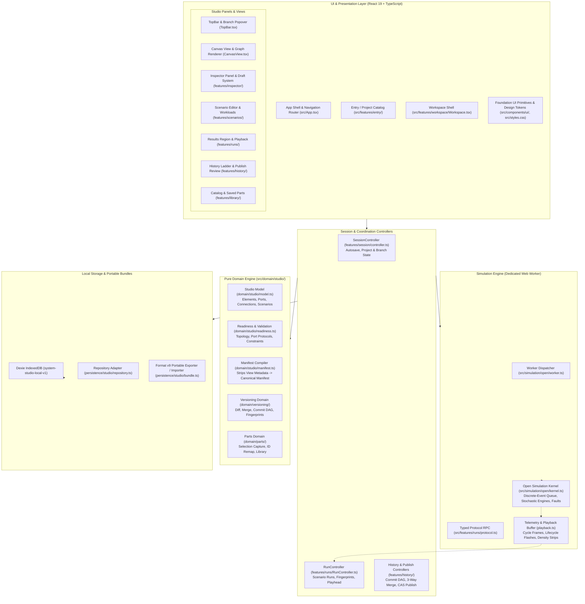
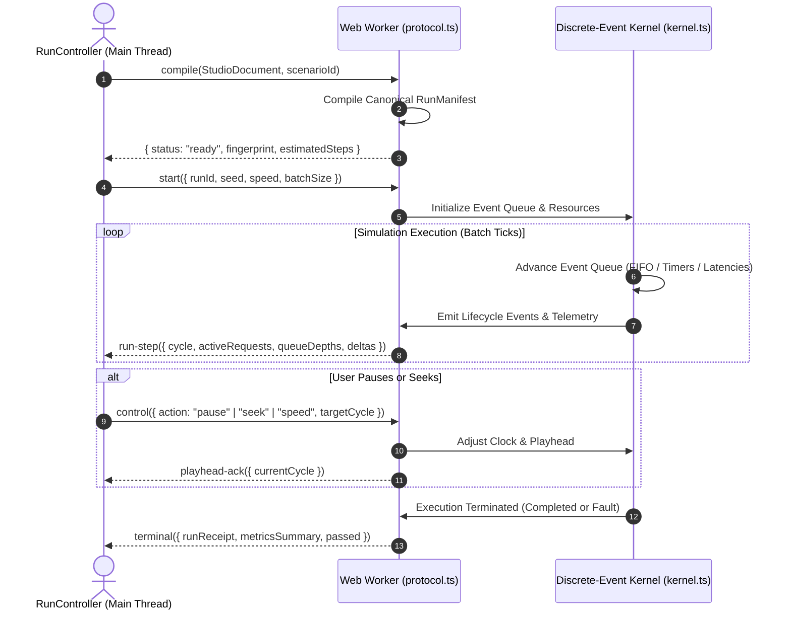

# System Studio — System Design & Architecture Specification

## Future scope: traffic state transitions

Deferred by user decision (2026-10-06): design the transitions between traffic states, including response-delivery acknowledgements, placement of arrival counts, repeated events under sustained load, and cue timing. Current work covers state presentation and shared node/footer hover behavior only. Historical spike placement also remains deferred.

> **Document Version:** 2.0 (Post-Revamp & Interactive Playback)  
> **Target Application:** System Studio (`system-design-planner`)  
> **Status:** Authoritative Design & Technical Architecture Document  
> **Theme:** Evergreen Paper (Light Mode Only, WCAG 2.2 AA Compliant)

---

## 1. Executive Summary & Philosophy

**System Studio** is an interactive, browser-based system architecture modeling, discrete-event simulation, and verification platform. It allows software architects, systems engineers, and learners to model complex distributed systems, execute realistic multi-scenario discrete-event simulations, inspect detailed packet/cycle lifecycles, and maintain architectural integrity using an immutable Git-like commit Directed Acyclic Graph (DAG) and 3-way semantic merging.

### Creative North Star: "Evergreen Paper"
Unlike traditional SaaS tools that lean on generic dashboards, heavy dark modes, or illustrative marketing fluff, System Studio is built as a **quiet, utilitarian, scan-friendly, paper-like studio**. It prioritizes high information density, strict control semantics, hairline borders, and predictable layout stability.

### Core Architectural Axioms
1. **Model / View Separation**: Canvas visual metadata (x/y coordinates, grouping boundaries, notes, colors) never enters the run manifest or affects simulation semantics.
2. **Simulation Accounting Integrity**: Exact FIFO queuing, per-attempt latencies, caller retry draws, broker redeliveries, and stochastic service distributions are strictly modeled. Nothing is reported as passed or measured unless executed.
3. **Off-Thread Discrete-Event Simulation**: The execution kernel runs strictly in a dedicated Web Worker via typed message protocols (`compile`, `start`, `control`, `step`, `terminal`), preventing main-thread UI jank.
4. **Draft Safety & Isolation**: All inspector and configuration changes are held in isolated drafts (`DraftSession`). Unapplied drafts prevent runs until explicitly applied or discarded.
5. **Verified Publication**: Committing or publishing to `main` requires completed, passing runs with matching exact-fingerprint receipts for every configured scenario.
6. **Local-First & Portable Persistence**: State is stored in browser-local IndexedDB (`system-studio-local-v1`) with zero remote dependencies, and exports to a portable, checksummed format v9 bundle.

---

## 2. High-Level System Architecture

System Studio is architected in four strict conceptual layers, preserving clean boundaries between rendering, workflow coordination, pure domain modeling, and off-thread simulation.



---

## 3. Foundation Design System (Evergreen Paper)

System Studio implements a **Foundation-First Design System** governed by [`.agents/rules/foundation-design-system.md`](file:///Users/ankushjamdagani/personal/system-design-planner/.agents/rules/foundation-design-system.md) and [`.agents/rules/frontend-guidance.md`](file:///Users/ankushjamdagani/personal/system-design-planner/.agents/rules/frontend-guidance.md).

All visual styling, tokens, radii, borders, and interaction states are centralized in [`src/styles.css`](file:///Users/ankushjamdagani/personal/system-design-planner/src/styles.css) and 41 foundation components in [`src/components/ui/`](file:///Users/ankushjamdagani/personal/system-design-planner/src/components/ui). Feature code in `src/features/*` orchestrates domain logic and layout; it never applies bespoke Tailwind overrides or utility styling hacks.

### 3.1 Color Palette & Token Roles
The design uses an **Evergreen paper** palette (light mode only, dark themes explicitly rejected per architectural decision D02/D24). All pairs meet WCAG 2.2 AA contrast standards (>= 4.5:1 for normal text, >= 3.0:1 for meaningful control boundaries).

| Role | Token Variable | Hex Value | WCAG Contrast / Usage |
|---|---|---|---|
| **Canvas** | `--canvas` | `#FFFFFF` | Main diagram drawing surface (with `#DCD7CD` 20px dot grid) |
| **Shell** | `--shell` | `#FBFAF7` | Application frame, navigation bar, footer |
| **Panel** | `--panel` | `#F7F5F1` | Docked and floating tool panels (Inspector, History, Library) |
| **Sunken** | `--sunken` | `#F2EFE9` | Recessed backgrounds, table headers, timeline track |
| **Ink (Body)** | `--foreground` / `--ink` | `#16201D` | Primary text and headlines (14.2:1 against paper) |
| **Secondary Ink** | `--secondary-text` | `#626D68` | Field labels, captions, metadata (4.94:1 against panel) |
| **Primary (Action)** | `--primary` | `#0B5C54` | Primary commands, Run buttons, focused elements (7.53:1) |
| **Primary Hover** | `--primary-hover` | `#0A4E47` | Active hover states on primary controls |
| **Primary Pressed** | `--primary-pressed` | `#083F3A` | Active click/press states |
| **Selected Tint** | `--accent` | `#EAEFEC` | Selection background in lists and cards |
| **Selected Edge** | `--selected-edge` | `#A8CBC5` | Selection highlight border around nodes and rows |
| **Branch / Async** | `--branch` | `#7C5FC0` | Versioning badges, async queues, messaging edges (4.54:1) |
| **Branch Tint** | `--branch-tint` | `#F7F4FC` | Soft lavender fill for message tags and branch chips |
| **Risk / Error** | `--risk` / `--risk-text` | `#A15B40` | Budget overruns, bottleneck alerts, failed SLA (4.62:1) |
| **Risk Tint** | `--risk-tint` | `#FBF1EA` | Soft clay fill for warnings and failing metrics |
| **Hairline Dividers** | `--border` | `#E7E3DB` | Clean structural dividing hairlines |
| **Control Border** | `--control-border` | `#DCD7CD` | Default border for inputs, buttons, and segmented controls |
| **Hover Border** | `--hover-border` | `#C6C0B4` | Border color on control hover |
| **Canvas Note** | `--note` / `--note-edge` | `#FBF6E8` / `#E6DAB8` | Amber-toned sticky notes and annotations |

### 3.2 Typography Tokens
System Studio specifies three distinct type families imported locally (no external CDNs), with strict semantic allocation:

1. **UI Sans (`--font-sans`):** `"IBM Plex Sans", system-ui, -apple-system, sans-serif`  
   - Used for all interface chrome, button labels, panel titles, inspector inputs, and body text.
   - Letter-spacing is strictly `0` (zero negative letter-spacing per design rules).
2. **Numeric & Data Mono (`--font-mono`):** `"IBM Plex Mono", ui-monospace, monospace`  
   - Used for all metrics, latencies, requests/s, ports, protocols, timestamps, and commit hashes.
   - Fixed tabular numeral alignment prevents UI jitter during live simulation playback.
3. **Display Serif (`--font-display`):** `"Newsreader Variable", Georgia, serif`  
   - Used sparingly for the brand logo mark, project titles, and formal publication review summaries.

### 3.3 Geometry, Elevation & Radii Tokens
- **Corner Radii:**
  - Tags & Small Badges: `4px`
  - Form Controls, Buttons & Inputs: `7px`
  - Node Cards on Canvas: `9px`
  - Popovers & Dropdown Menus: `11px`
  - Modal Dialogs & Major Cards: `12px`
  - Canvas Floating Dock: `14px`
- **Control Semantics:**
  - Tools $\rightarrow$ Icon buttons with Lucide icons and hover tooltips.
  - Modes $\rightarrow$ Segmented controls (e.g. Select vs Connect vs Pan).
  - Binary Settings $\rightarrow$ Explicit toggles/checkboxes.
  - Numbers $\rightarrow$ Steppers or validated numeric inputs with unit suffixes.
  - Option Sets $\rightarrow$ Menus and select dropdowns.
  - Views $\rightarrow$ Tab bars with hairline active indicators.

---

## 4. UI Shell & Presentation Architecture

The user interface is hosted in [`src/features/workspace/Workspace.tsx`](file:///Users/ankushjamdagani/personal/system-design-planner/src/features/workspace/Workspace.tsx) and managed by modular panels dockable across left, right, bottom, or floating configurations.

### 4.1 Shell Layout Breakdown
```
+-----------------------------------------------------------------------------------------------+
| TopBar: [App Mark] · [Project / Branch [DRAFT] ▾] · [⌘K Quick Options] · [History] [Library] [Run] |
+------------------+---------------------------------------------------------+------------------+
|                  |                                                         |                  |
| Docked Left      | Central Canvas (20px Dotted Paper Grid)                 | Docked Right     |
| (Optional):      |                                                         | (Optional):      |
| - Library /      |  [Node: Client] ──(HTTP)──> [Node: Gateway]             | - Inspector:     |
|   Catalog        |                                   │                     |   Configuration, |
| - Scenarios      |                                (gRPC)                   |   Measured run,  |
| - Collapsed rail |                                   ▼                     |   Apply / Cancel |
|                  |                           [Node: Service]               |                  |
|                  |                                                         |                  |
|                  | +-----------------------------------------------------+ |                  |
|                  | | Canvas Dock: Undo Redo | Select Pan Node Edge | Fit | |                  |
|                  | +-----------------------------------------------------+ |                  |
+------------------+---------------------------------------------------------+------------------+
| Bottom Region: Results & Playback Controls                                                    |
| [Play/Pause] [Seek] [Speed x1] [Timeline Density Strip] [Total Reqs | Latency p95 | Failures]  |
+-----------------------------------------------------------------------------------------------+
```

### 4.2 Main View Components
- **TopBar ([`src/features/workspace/TopBar.tsx`](file:///Users/ankushjamdagani/personal/system-design-planner/src/features/workspace/TopBar.tsx)):** Houses project branding, editable project title, branch switch popover, Quick Options palette (`⌘K`), global undo/redo, and the primary "Run Simulation" trigger.
- **CanvasView ([`src/features/workspace/CanvasView.tsx`](file:///Users/ankushjamdagani/personal/system-design-planner/src/features/workspace/CanvasView.tsx)):** Renders the infinite dotted workspace, component node cards (nominal width `176px`), ports with protocol badges, directional Bezier connection paths, and sticky notes.
- **Canvas Dock ([`src/features/workspace/Dock.tsx`](file:///Users/ankushjamdagani/personal/system-design-planner/src/features/workspace/Dock.tsx)):** Floating pill dock providing tool selection (Pointer, Pan, Node placement, Connect, Note, Zoom In/Out, Fit-to-screen).
- **Inspector ([`src/features/inspector/InspectorPanel.tsx`](file:///Users/ankushjamdagani/personal/system-design-planner/src/features/inspector/InspectorPanel.tsx)):** Right dock providing dual tabs:
  - *Configuration Tab:* Allows editing node name, capacity, service distribution, worker threads, port protocols, and route conditions. Changes trigger an isolated draft session requiring explicit `Apply` or `Cancel`.
  - *Measured Tab:* Displays empirical post-simulation utilization, queue lengths, latency distributions, and drop counts for the selected component.
- **Scenario Editor ([`src/features/scenarios/ScenarioEditor.tsx`](file:///Users/ankushjamdagani/personal/system-design-planner/src/features/scenarios/ScenarioEditor.tsx)):** Manages workloads, duration, warmup cycles, burst/ramp profiles, SLA assertions (latency thresholds, error rate caps), and fault injection schedules.
- **Results & Playback Region ([`src/features/runs/ResultsRegion.tsx`](file:///Users/ankushjamdagani/personal/system-design-planner/src/features/runs/ResultsRegion.tsx)):** Synchronized playback panel with playhead scrubber, speed controls ($\times 0.25$ to $\times 16$), density strip for large cycle sets ($>200$ cycles), bottleneck indicators, and per-step telemetry inspection.
- **History Ladder ([`src/features/history/HistoryPanel.tsx`](file:///Users/ankushjamdagani/personal/system-design-planner/src/features/history/HistoryPanel.tsx)):** Git-like commit tree displaying commit checkpoints, verification receipts, branch heads, 3-way merge conflict resolution, and atomic compare-and-set publication to `main`.
- **Component Library ([`src/features/library/LibraryPanel.tsx`](file:///Users/ankushjamdagani/personal/system-design-planner/src/features/library/LibraryPanel.tsx)):** Standard catalog of distributed system building blocks (Clients, Gateways, Load Balancers, Services, Caches, Queues, Databases, Object Storage) and reusable saved parts.

---

## 5. Domain Engine Architecture (`src/domain/`)

The domain layer is pure TypeScript, completely decoupled from React, the DOM, and IndexedDB storage. It can run in any environment (main thread, Web Worker, or headless test runner).

### 5.1 Document Model ([`src/domain/studio/model.ts`](file:///Users/ankushjamdagani/personal/system-design-planner/src/domain/studio/model.ts))
The root document entity is the `StudioDocument`, representing a complete system specification:

```typescript
export interface StudioDocument {
  readonly schema: 'studio-document/1';
  readonly id: Id;
  readonly title: string;
  readonly elements: readonly ElementRecord[];
  readonly connections: readonly ConnectionRecord[];
  readonly relations: readonly StructuralRelationRecord[];
  readonly schemas: readonly PayloadSchemaRecord[];
  readonly fixtures: readonly FixtureRecord[];
  readonly refinements: readonly RefinementRecord[];
  readonly scenarios: readonly ScenarioRecord[];
  readonly views: readonly ViewRecord[];
}
```

Key Domain Entities:
- **`ElementRecord`:** A discrete architectural building block (e.g. `service`, `database`, `queue`, `router`, `cache`, `client`). Contains typed ports (`in` and `out`), capacity limits, concurrency parameters, and operational behavior definitions.
- **`Port`:** An attachment interface on an element specifying direction (`in`/`out`), transport protocol (e.g., `http`, `grpc`, `amqp`, `sql`, `redis`), routing path, and delivery guarantees (e.g., `at-least-once`, `fifo`).
- **`ConnectionRecord`:** A directional edge connecting an `out` port to an `in` port. Models physical network links with configured latency, bandwidth, packet loss rate, and transport protocol.
- **`ScenarioRecord`:** A self-contained simulation workload definition specifying the target entry elements, traffic profile (steady, Poisson, burst, ramp), duration, seed, fault injections, and SLA verification assertions.
- **`ViewRecord`:** Presentation-only layouts specifying visual node coordinates, groupings, collapsed states, and canvas notes. Strictly excluded from simulation manifests.

### 5.2 Readiness & Validation ([`src/domain/studio/readiness.ts`](file:///Users/ankushjamdagani/personal/system-design-planner/src/domain/studio/readiness.ts))
The readiness engine validates graph integrity across five progressive stages:
1. **Sketch:** Nodes and connections placed on canvas.
2. **Behavior Specified:** Every element has assigned capacities, queue depths, and processing times.
3. **Scenario Configured:** Entry points connected to workloads with specified request classes and rates.
4. **Runnable:** Ports have compatible protocols, routes reach terminating resources, and no invalid synchronous cycles exist.
5. **Verified:** Scenarios executed to completion, passing all SLA checks.

### 5.3 Manifest Compiler ([`src/domain/studio/manifest.ts`](file:///Users/ankushjamdagani/personal/system-design-planner/src/domain/studio/manifest.ts))
The manifest compiler strips all visual view metadata, validates the behavioral graph against scenario constraints, and generates an immutable, canonical **Run Manifest** (`RunManifest`) passed to the simulation worker.

---

## 6. Simulation & Execution Kernel (`src/simulation/open/`)

The simulation engine is a deterministic, discrete-event simulation (DES) kernel executing inside a dedicated Web Worker ([`src/simulation/open/worker.ts`](file:///Users/ankushjamdagani/personal/system-design-planner/src/simulation/open/worker.ts)) over a typed RPC protocol ([`src/features/runs/protocol.ts`](file:///Users/ankushjamdagani/personal/system-design-planner/src/features/runs/protocol.ts)).

### 6.1 Worker Protocol & Lifecycle


### 6.2 Discrete-Event Mechanics
- **Queue Accounting:** Bounded FIFO queues per resource with exact head-of-line blocking, slot reservation, and drop tracking.
- **Service Distributions:** Supports deterministic processing times, exponential service rates, and lognormal heavy-tail distributions.
- **Network Link Modeling:** Default 2ms network hops with packet serialization and transmission latency.
- **Caller Retries:** Configurable retry counts with exponential backoff and randomized jitter.
- **Broker Fanout & Redelivery:** Message queues support fanout broadcasting, consumer groups, message expiration (TTL), and unacknowledged redelivery.
- **Fault Injection:** Injects node crashes, port partitions, latency spikes, and packet corruptions at precise simulated timestamps.

### 6.3 Telemetry & Playback Synchronization
- **Playhead Synchronization:** The playhead links the canvas traffic animations, timeline scrubber, and metrics results table to the exact simulated millisecond.
- **Density Strip:** For long runs ($>200$ cycles), the timeline collapses individual cycle bands into a high-density heatmap strip highlighting bottleneck regions and SLA faults.
- **Lifecycle Flashes:** Canvas nodes render subtle, transient visual cues for packet admissions, processing starts, and outcome completions (send, arrival, error).

---

## 7. Versioning & Commit DAG (`src/domain/versioning/`)

System Studio incorporates a local Git-like version control engine for distributed system designs ([`src/domain/versioning/`](file:///Users/ankushjamdagani/personal/system-design-planner/src/domain/versioning)).

### 7.1 Commit Graph & Branching
- **Commit Records:** Immutable snapshot records storing parent commit IDs, author metadata, timestamp, document snapshot hash, and verification receipts.
- **Branch Pointers:** Mutable local pointers (`main`, feature branches) referencing specific commit nodes.
- **Working Snapshot:** Uncommitted drafts held in a branch-specific working buffer.

### 7.2 Three-Way Semantic Merge ([`src/domain/versioning/merge.ts`](file:///Users/ankushjamdagani/personal/system-design-planner/src/domain/versioning/merge.ts))
When merging a feature branch into `main`:
1. The engine computes the **Merge Base** (lowest common ancestor commit in the DAG).
2. Performs element-by-element, port-by-port, and scenario-by-scenario 3-way diffing:
   - Non-overlapping additions and updates merge automatically.
   - Conflicting property changes on identical elements trigger explicit conflict records.
3. The merged candidate document must pass readiness checks and execute all scenarios successfully before publication.

### 7.3 Verified Publication & Compare-And-Set (CAS)
- Committing or publishing to `main` requires completed, passing runs with **matching exact-fingerprint receipts** for every configured scenario.
- Publication is executed as an atomic Compare-And-Set (CAS) transaction against IndexedDB: if `main` moved in another tab, the transaction aborts, prompting the user to rebase.

---

## 8. Local Storage & Bundle Architecture (`src/persistence/studio/`)

System Studio uses a strictly local-first storage design. No diagrams or simulation runs are sent to remote servers.

### 8.1 IndexedDB Database Schema
- **Database Name:** `system-studio-local-v1` (managed via Dexie).
- **Tables:**
  - `projects`: Project metadata, active branch pointer, created/updated timestamps.
  - `commits`: Immutable commit DAG entries.
  - `branches`: Named branch heads referencing commit IDs.
  - `workingCopies`: Active uncommitted document snapshots per branch.
  - `runReceipts`: Cryptographically verified simulation execution results keyed by run fingerprint.
  - `parts`: Reusable saved components and subgraphs.

### 8.2 Portable Bundle Format v9 (`system-studio` v9)
Projects export and import using a standardized, self-contained JSON format v9 bundle:
- Uses Canonical JSON (`canonical-json-v1`) with sorted keys and stable float formatting.
- Includes a SHA-256 integrity checksum over the document payload.
- Legacy format bundles (v7/v8) are strictly rejected with typed errors; no automatic migration is performed, protecting data integrity.

---

## 9. End-to-End Data Flows

### Flow 1: Visual Authoring to Canonical Manifest Compilation
```
[User Canvas Interaction] ──> [Workspace State Reducer]
                                      │
                                      ▼
                             [StudioDocument Update]
                                      │
                           [Readiness Validator]
                             ├──> Valid? ──No──> [Inline Inspector Diagnostics]
                             │
                            Yes
                             │
                             ▼
                    [Manifest Compiler]
                 (Strips View Coordinates/Notes)
                             │
                             ▼
                    [Canonical RunManifest]
```

### Flow 2: Simulation Execution, Telemetry, and Playback
```
[RunController] ──> postMessage("start", RunManifest) ──> [Worker Kernel]
                                                                │
                                                    [Discrete-Event Queue]
                                                                │
[PlaybackPanel] <── postMessage("run-step", Telemetry) <───────┘
       │
       ├──> Updates Playhead Scrubber & Timeline Strip
       ├──> Triggers Node Lifecycle Flashes on Canvas
       └──> Updates Live Latency / Throughput / Queue Counters
```

### Flow 3: Scenario Verification, Commit DAG, and Publication
```
[Run Complete] ──> [Verify Scenario SLA Assertions]
                          │
                   All Passed?
                    ├── No  ──> [Mark Failed, Block Commit]
                    └── Yes ──> [Generate Cryptographic RunReceipt]
                                      │
                          [Create Immutable Commit]
                                      │
                         [3-Way Semantic Merge Review]
                                      │
                         [CAS Atomic Publish to Main]
```

---

## 10. Core Architectural Invariants

Preserve in all future development:
1. **Model / View Separation**: Canvas visual metadata (x/y coordinates, group boundaries, sticky notes) never enters the run manifest or affects simulation semantics.
2. **Simulation Accounting**: Strict separation between configured architecture and observed results; exact per-attempt latency, FIFO queuing, and retry draws. The retained open kernel (`src/simulation/open/`) is pinned by characterization goldens.
3. **Draft Safety**: Unapplied inspector changes remain in isolated drafts (`DraftSession`). An invalid draft blocks simulation runs until explicitly applied or discarded.
4. **Verified Publication**: Committing or publishing to `main` requires completed, passing runs with matching exact-fingerprint receipts for every configured scenario.
5. **Portable Persistence**: Only format v9 bundles import; older versions (v7/v8) are rejected with a clear message. The legacy `system-studio` database is never touched.
6. **Foundation-First UI**: Foundation components (`src/components/ui/`) and tokens (`src/styles.css`) are the core of the app. Never use ad-hoc Tailwind overrides in feature code.

---

## 11. Codebase Module Map & Navigation

| Subsystem | Directory / Key Files | Primary Responsibility |
|---|---|---|
| **Foundation UI Primitives** | [`src/components/ui/`](file:///Users/ankushjamdagani/personal/system-design-planner/src/components/ui) | 41 CVA-based accessible UI components (Button, Dialog, Popover, Input, Slider, Resizable, etc.). |
| **Design Tokens & Theme** | [`src/styles.css`](file:///Users/ankushjamdagani/personal/system-design-planner/src/styles.css) | Core Evergreen paper design tokens, typography imports, and Tailwind v4 theme bindings. |
| **App Shell & Entry** | [`src/App.tsx`](file:///Users/ankushjamdagani/personal/system-design-planner/src/App.tsx), [`src/features/entry/`](file:///Users/ankushjamdagani/personal/system-design-planner/src/features/entry) | Navigation router, project catalog, template loaders, and lazy-loaded route boundaries. |
| **Workspace & Canvas** | [`src/features/workspace/`](file:///Users/ankushjamdagani/personal/system-design-planner/src/features/workspace) | CanvasView, docking system, tool dock, pan/zoom engine, and keyboard command registry. |
| **Inspector & Drafts** | [`src/features/inspector/`](file:///Users/ankushjamdagani/personal/system-design-planner/src/features/inspector) | Dual-tab property editor with atomic Apply/Cancel draft session management. |
| **Scenario Management** | [`src/features/scenarios/`](file:///Users/ankushjamdagani/personal/system-design-planner/src/features/scenarios) | Workload builders, burst/ramp traffic profiles, and SLA assertions. |
| **Runs & Playback** | [`src/features/runs/`](file:///Users/ankushjamdagani/personal/system-design-planner/src/features/runs) | `RunController`, `ResultsRegion`, `PlaybackPanel`, timeline density strip, and playhead synchronization. |
| **History & Versioning** | [`src/features/history/`](file:///Users/ankushjamdagani/personal/system-design-planner/src/features/history) | Git-like commit tree, branch switcher, 3-way merge conflict resolver, and publication review. |
| **Parts & Library** | [`src/features/library/`](file:///Users/ankushjamdagani/personal/system-design-planner/src/features/library) | Component catalog, saved architecture templates, and reusable parts. |
| **Domain Engine** | [`src/domain/studio/`](file:///Users/ankushjamdagani/personal/system-design-planner/src/domain/studio) | Pure domain model (`model.ts`), readiness checks (`readiness.ts`), and manifest compiler (`manifest.ts`). |
| **Versioning Engine** | [`src/domain/versioning/`](file:///Users/ankushjamdagani/personal/system-design-planner/src/domain/versioning) | Commit DAG, 3-way semantic merge (`merge.ts`), base discovery, and fingerprinting. |
| **Simulation Kernel** | [`src/simulation/open/`](file:///Users/ankushjamdagani/personal/system-design-planner/src/simulation/open) | Discrete-event simulation kernel (`kernel.ts`), worker entrypoint (`worker.ts`), and characterization tests. |
| **Persistence & Storage** | [`src/persistence/studio/`](file:///Users/ankushjamdagani/personal/system-design-planner/src/persistence/studio) | Dexie IndexedDB adapter (`repository.ts`, `db.ts`) and format v9 portable bundle exporter. |
