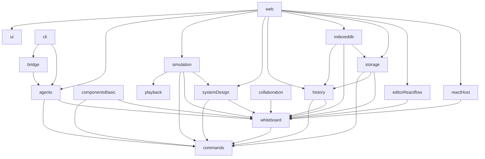

# ADR: extract one document authority and preserve atomic editing

Status: selected implementation direction, not completed cutover. Scope: phases 1–6 of `../composable-architecture-plan.md`. Baseline: `0c4a439`. Future changes occur only in worktrees/feature branches with user-merged PRs.

## Current evidence

`src/features/session/controller.ts` SessionController currently owns state, in-flight serialization and undo/redo stacks. `apply` computes inverses, executes model.apply-records through StudioRepository and reloads the paired branch/snapshot before adopting it. `executeAndAdopt` sets needsReload if post-write reload fails; further editing is blocked. `autoDraftFromMainIfNeeded` creates a draft before the first edit; the branch creation is not an undo entry. `src/features/session/session.test.ts` characterizes stale failures, snapshot/revision pairing, stack resets and the 100-entry bound.

`src/persistence/studio/apply-records.ts` applyRecordChanges already rejects duplicate targets in one batch, missing records, oversized changes and invalid full documents. `src/features/session/inverse.ts` computeInverseChanges derives prior records and reverses the operation sequence. `src/persistence/studio/types.ts` combines consumer contracts with Dexie-oriented records and system-specific evidence; extraction must redistribute those types, not preserve this combined dependency surface as a new shared package.

## Authority decision

Extract the existing editing kernel into whiteboard. There is one mutable service instance per board with immutable published snapshots and a serialized transaction queue. Editor-reactflow emits neutral intents; system-design planners return changes; agents submit proposals; history applies inverses through the same authority; storage persists results. None owns another writable document or keeps an editable system Document alongside BoardDocument.

Temporary app facades delegate one way into the extracted kernel. No package imports the app facade. A read-only serialization/projection may materialize a system snapshot for execution or storage; that immutable projection cannot accept edits. The app composes services and chooses presentation/confirmation policy, while feature services determine guard, eligibility and draft outcomes.

## Contracts and mutation algebra

Whiteboard exports Actor/Scope, document/entity/placement/connector types, validation issues, transaction intents/operations/results, EditorAdapter, DomainContribution, DocumentTransactionStore, TransactionParticipant, commit observer and UndoPort. History exports its version records/store/controller contracts. Storage exports backend/envelope/capability contracts. Commands exports only generic definitions/principal context/discovery/execution. Each package owns its contracts; there is no contracts/core/runtime package.

Initial operation vocabulary is insert, replace and remove identified records with before-value or absent preconditions. Transaction envelope contains operationId, project/branch/board scope, actor, expected revision, operations and history intent (normal/undo/redo plus target entry ID). Kernel normalizes record targets, rejects multiple mutations of one target in a transaction initially, captures exact before values and derives inverse operations in reverse order. Insert inverses remove; remove inverses insert the prior value; replace inverses replace with the prior value. Reject missing targets, nonfinite/non-JSON data and unbounded payloads before persistence. Nested placement or extension updates replace one identified record/value; future field updates require equally explicit preconditions and inverse derivation.

Validate the full candidate using whiteboard core validation and injected deterministic synchronous domain validation. Domain planners resolve stable port IDs and plan dependent connectors/refinements/placements together. No arbitrary JSON Patch, callback mutation or whole-document overwrite is an agent API. No exports, network/model calls or simulation starts enter the invertible authored algebra. Existing UUID IDs remain intact; readable IDs are a separate schema decision with conversion fixtures, never a casual validator relaxation.

## Atomic transaction coordination

1. Resolve scope/targets and captured revision; authorize the actor and requested capability.
2. Plan operations; derive candidate and inverse; validate all core/domain references.
3. Invoke registered participants to prepare immutable namespaced contributions and preconditions. Participants cannot write or mutate session state.
4. DocumentTransactionStore sends one envelope to storage coordinator. In one backend transaction, coordinator checks receipt identity/request hash, project/branch revision/head and participant preconditions; persists candidate snapshot/pointer, project changes, version records/evidence references and receipt.
5. Publish paired document/revision/snapshot result only after a committed receipt. Notify undo/subscriptions after publishing. No post-commit listener performs required durable history writes.

Backend adapters either support all required contribution handlers atomically or return unsupported before writes. Memory and IndexedDB run the same failure-injection/CAS/receipt conformance suite. Identical operation retry returns the receipt; reused identity with different request fails. A durable success followed by failed reload is committed-but-needs-reload, not a fictional rollback; retry must discover the receipt. Cancellation after commit returns committed result. Precommit failure retains recoverable draft/intention and leaves authored snapshot/stacks untouched.

Version-only transactions use the same coordinator. History supplies version-head changes; system-design supplies pure publication policy over immutable candidate plus persisted evidence summary; simulation maps artifacts to that summary. The coordinator rechecks head/fingerprint/evidence preconditions. No live RunController reference is required to publish. Preserve the current automatic draft-on-main behavior initially, including its separate branch creation; do not claim that existing two-step sequence is already one atomic operation.

## Undo and drafts

History UndoController observes successful normal authored commits, groups one gesture or accepted proposal into one entry, caps retention at current 100 entries initially and clears redo on new ordinary edits. Undo/redo submit a new scoped transaction with history intent and entry identity; successful receipt moves the existing entry between stacks instead of adding a recursive undo entry. Failure/staleness leaves both stacks intact. Serialize inverse submissions. Keep the accepting human as commit actor and proposedBy as agent provenance for accepted proposals.

Opening another branch/project or reloading a fresh session clears local stacks as current tests establish. Restore/merge must retain current tested reset behavior; implementation adds explicit tests for each path before moving controllers. External revisions invalidate or disable inverse applicability until reload; actor-scoped multiplayer undo is deferred. Branch creation itself is not undoable. System-design owns validated inspector/scenario draft plans; whiteboard owns apply/discard/stay navigation decisions; app renders the dialog. Drag/drawing previews stay adapter-local and cancellation creates no commit.

## Codec and reload cutover

Retain current database/schema/name/actor keys first. Introduce explicit storage codec with deterministic Document-to-BoardDocument and reverse authored projection; field coverage is in `field-ownership.md`. Codec is persistence projection only. Historical immutable rows preserve original payloads, IDs and hashes; new-format references must not rewrite originals. Existing archive import validation remains until an independently reviewed format change. User waived released-format compatibility promises, not recoverable current data.

Cut over at normal app reload: stop initiating edits, wait for pending commits, resolve/export recoverable drafts, dispose old controller/workers/subscriptions, then initialize the new composition from durable state. Do not hot-transfer gestures/drafts/undo stacks or run both controllers as writers. A failed codec/load enters typed unavailable/recovery state with original data intact. Temporary memory editing is an explicit user choice, never silent fallback. New archive/schema cutover needs its own retryable conversion/export decision and fixtures; package extraction does not automatically authorize it.

## Dependency graph

Arrows mean imports through public exports, including type imports. Optional UI entries cannot contaminate headless roots.

`playback` and `commands` are feature-neutral leaves; ui depends only on presentation libraries. Whiteboard owns ports that history/storage implement, preventing reverse imports. System-design injects publication/merge/resolver policy; storage does not import system-design/simulation. Bridge has separate neutral protocol, Node `/server` and browser `/browser` build entries. Apps compose feature registrations; imports never self-register globally.

## Implementation assignments and gates

| Work slice | Assignment boundary | Must prove before proceeding |
| --- | --- | --- |
| Scaffold / leaf UI | apps/web routes/config/public assets and npm workspaces; ui foundation only after stylesheet/import mapping | Same routes/SSR/PWA, builds, no new reduced workspace; embedding and Storybook paths retained |
| Generic playback | Extract only feature-neutral clock/transport primitives; leave PlaybackStore recording indexes with simulation until dependencies exist | No system/React/DOM imports; characterized range behavior remains |
| Commands 3a | Generic registry plus feature registration seams; app owns palette actions | Existing F2/menu/button behavior, execution recheck/schema errors/disposal; Cmd+K 3b separately |
| Whiteboard + system-design | Joint semantic/entity/placement mapping and existing SessionController authority extraction | Every ownership row covered, inverses/core+domain validation, no second writable state, codec fixtures |
| Editor | CanvasView projection/gestures behind whiteboard EditorAdapter; keep default renderers overridable | React Flow and minimal test adapter share document/selection/viewport/geometry/capability conformance |
| Storage + history | Split coordinator/backend and local undo/version controllers; no panels in history | Memory/IndexedDB atomic failures, stale requests, duplicate identity, postcommit reload and current history/publication parity |
| Complete composition | Replace Workspace direct service construction with injected facades | Every parity row retained, multiple board disposal/SSR safety; then AI may integrate |
| Agents + bridge + CLI | Proposal kernel first, then local pairing/browser ingress/MCP/provider/UI | Bounded context, scoped auth, stale/duplicate proposals, one acceptance undo, host HTTPS/browser permission gate |

No parallel source assignment may mutate SessionController, repository orchestration or the authority schema without one lead-owned integration decision. Inspect direct source before each move; a stale graph is navigation evidence only. Release completion requires units, package builds/headless/import checks, Next build, Storybook, full isolated production journeys and embedding checks. This ADR defines the gates; it does not assert they passed.
