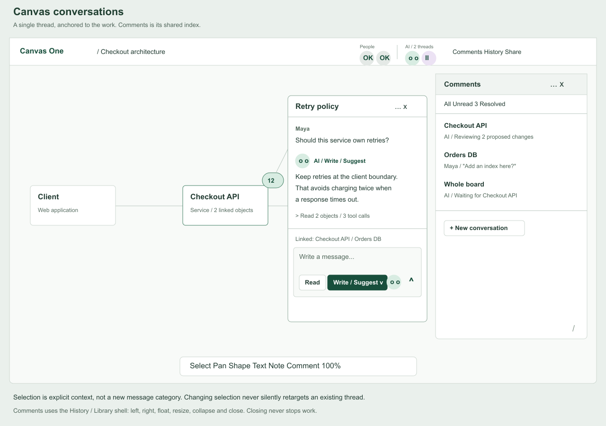
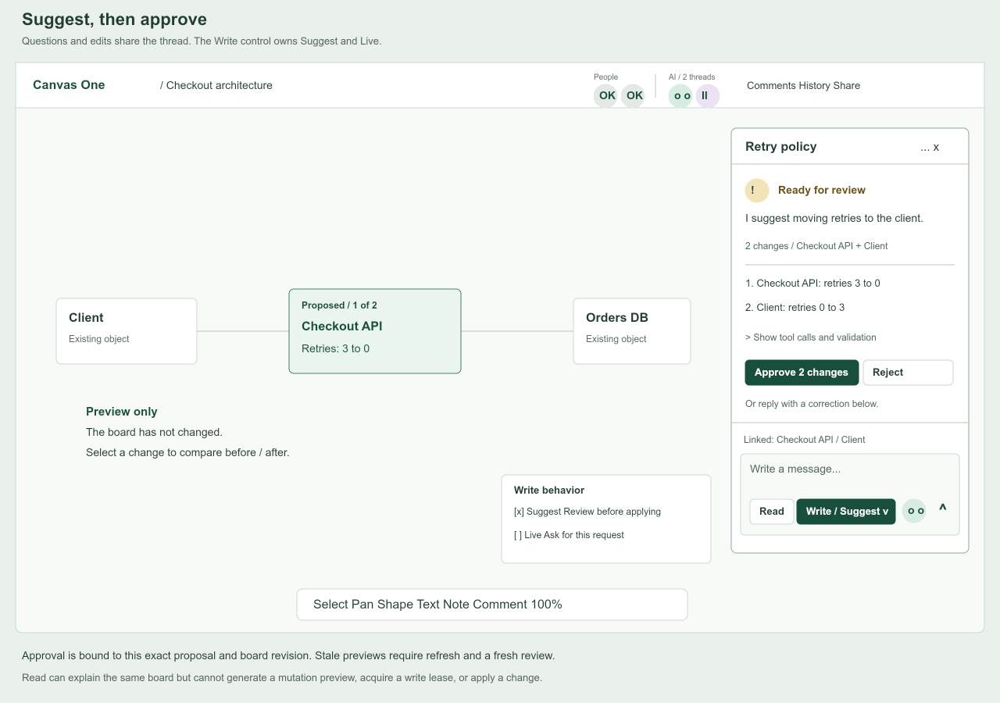

# Canvas conversations proposal

Design review material, not implemented application behavior.

- [Editable OpenPencil document](<Canvas One - Conversations Revamp.fig>): four pages — Canvas conversation, Suggest review, Live and conflicts, Presence and motion.
- [Experience specification](experience-spec.md): decisions, alternatives, permission boundaries, comment model, concurrency, motion and acceptance scenarios.
- [AI action skill](../../../.agents/skills/canvas-collaboration/SKILL.md): concise evolving capability vocabulary and execution boundaries. Planned actions require host capability discovery; this is not a tool installation.

## Review evidence and limits

Created as editable SVG-derived vector/text layers through the OpenPencil desktop UI, then saved as its native `.fig` archive. The supplied State 01 reference was opened read-only and preserved separately. Native file existence/archive integrity and both 1280 × 900 PNG exports were checked. Screens 1–3 were visually inspected in OpenPencil; scope labels in screen 2 were corrected. Screen 4's content was imported and saved, but its rendered visual inspection was blocked when the editor stopped repainting its canvas. A fresh-canvas attempt did not recover rendering; browser-editor fallback timed out. A full native reopen round trip was also blocked by the disabled Open dialog. Do not claim those checks passed.

Native lint reports remain on the first three wireframes: white-on-green button text is flagged against the enclosing white SVG frame, a resize marker has low contrast, and two header group labels are 10px. These static wireframes are not an accessibility sign-off; use production tokens, accessible labels and foundation controls when implementing. Face/tool text is schematic, and animation timing is specified rather than animated in the file. No runtime app source changed, so unit, production build, browser and Storybook suites were not run.

Skill frontmatter/name/description and placeholder checks passed with Ruby's YAML parser. The bundled Python quick validator could not run because PyYAML is absent in both available Python environments. Diff whitespace check passed. Local contract review distinguishes current one-writer support from proposed scope-aware concurrency. The configured external agy review was rejected by automatic approval review before execution because payload-specific authorization to send these internal files to the external model service was unclear; no independent external verdict is claimed.
