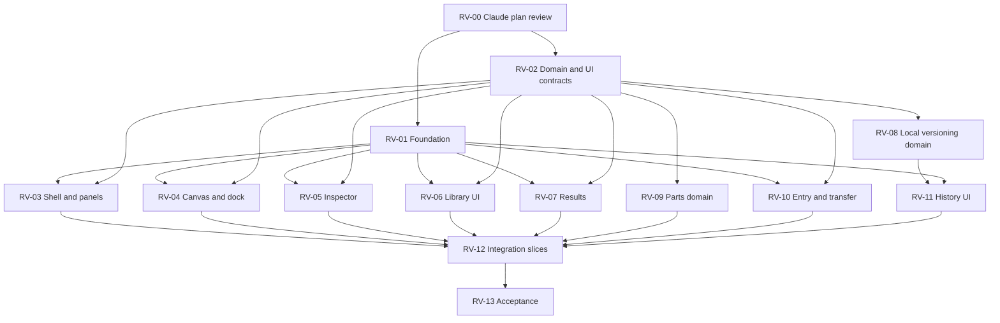

# Delivery plan and ownership

Codex is lead/planner/final verifier. Claude reviews plans, contracts and implementation. Gemini/agy performs implementation and integration edits. Cross-platform starts require the user's switch; the table is a plan, not a claim that agents were dispatched.

## Gates and parallel waves

Run at most three implementation lanes at once, on isolated branches/worktrees. Suggested early lanes after contracts/foundation: shell/panels, canvas/dock, versioning domain. While versioning takes time, completed lanes can take inspector, library presentation, results or exporters. Review completed slices continuously; don't wait for the entire product. UI built against fixtures remains REVIEWABLE, not DONE, until integrated with real state.

## Bounded work packages

Every path below is an ownership boundary proposal. Before READY, record exact files in the task ledger; no globs granting ownership of an entire shared subsystem. Existing files not listed are read-only. New tests belong to the task that introduces the behavior.

### RV-00 — Senior plan review

- Owner: Claude, read-only review; Codex records decisions/updates planning docs.
- Input: this plan, full source ZIP, decisions, HANDOFF and current source anchors.
- Output: severity-ranked findings with requirement/screen/code evidence; approve or reject component boundaries, migration strategy, run identity, merge semantics and task split.
- Exit: no unresolved critical/high architecture or data-loss finding. This is READY now.

### RV-01 — Foundation and design specimen

- Owner: Gemini; Claude reviews before consumers migrate.
- Owns: `components.json`, `src/styles.css`, `src/components/ui/` exact inventory, new `src/components/studio/` shared primitives, foundation specimen/tests; package/lock/font imports only while holding shared dependency lock.
- Dependencies: RV-00; D02/D07/D08/D13 confirmed.
- Deliver: semantic tokens, font/mark/icon mapping, vetted missing shadcn components, layered native styles, full state specimens and overlay stack policy.
- Exit: R02/R11; component/browser checks and build; compare to foundation canvas. No domain behavior edits.

### RV-02 — Executable contracts and migration specification

- Owner: Codex authors specification; Claude reviews. Gemini may produce bounded read-only fixture-size/compatibility evidence.
- Owns: new contract specification and fixture descriptions under `specs/revamp/contracts/`; actual shared TypeScript contract creation is a later Gemini task with an exact file list.
- Dependencies: RV-00; all D09–D14 settled.
- Deliver: concrete data types, state transition tables, numeric limits, portable/Dexie versions, legacy mapping, run fingerprint fields, command/panel API, fixture catalog, parts boundary rules, merge cases, abort/recovery policy.
- Exit: no unresolved storage/interaction contract before related implementation starts. Contract review is not satisfied by this high-level technical proposal alone.

### RV-03 — Shell, command palette and panel host

- Owner: Gemini; owns new `features/workspace/` files, `TopBar.tsx`, `ActivityRail.tsx`, shell-specific tests; excludes App/global CSS/editor.
- Dependencies: accepted RV-01/02.
- Deliver: project/branch adapters, real command availability, dock/float/stack/collapse host, bounds/preferences and keyboard/touch placement. Screens 22A nav, 13A/B, 14A, 18A, 23A–G.
- Exit: R03/R04/R11, placement reducer tests and focused browser fixtures including reload/viewport change. Integrator wires project/branch saves.

### RV-04 — Canvas appearance and customizable dock

- Owner: Gemini; owns `ArchitectureCanvas.tsx`, `SubsystemNode.tsx`, `TrafficEdge.tsx`, `CanvasNotes.tsx`, `CanvasContextMenu.tsx`, `DiagramOrganization.tsx`, `layout/CanvasFloatingDock.tsx`, associated dedicated canvas CSS/tests.
- Dependencies: accepted RV-01/02; no concurrent writer to these files.
- Deliver: 2A workspace/16A–D visual treatment and dock customization through workspace command/preferences contracts.
- Exit: R05/R11 plus notes/group/export/viewport regression journeys. No engine or editor changes outside a separately assigned integration patch.

### RV-05 — Transactional inspector

- Owner: Gemini; owns `OpenInspector.tsx`, `Inspector.tsx`, `OpenConnectionEditor.tsx`, `OpenWorkloadControls.tsx`, `ServiceModelEditor.tsx`, `NumberField.tsx`, `JobControls.tsx`, `RoutingPanel.tsx`, `SubsystemsPanel.tsx` and inspector tests after exact consumer inventory.
- Dependencies: RV-01/02; shared atomic editor API supplied by RV-12 integration task, not independently edited here.
- Deliver: draft/validation/Apply/Cancel for configuration surfaces; measured section; dirty-navigation coordination.
- Exit: R06/R11, no partial mutation, one-step undo, stale-target detection, archived controls remain read-only. Notes retain explicit apply behavior.

### RV-06 — Library presentation

- Owner: Gemini; owns new `features/library/` UI and tests only.
- Dependencies: RV-01/02; can proceed with deterministic fixtures while RV-09 develops domain.
- Deliver: same library from dock/panel; search/list/grid/details, empty/error states and save/place controls. Screens 12A–C/16E.
- Exit: R07/R11 against fixtures; final acceptance requires RV-09 and real integration, not hard-coded counts.

### RV-07 — Results presentation

- Owner: Gemini; owns `layout/ResultsStrip.tsx`, `OpenMetricsPanel.tsx`, `ResultsPanel.tsx`, new `features/results/` adapters/tests.
- Dependencies: RV-01/02.
- Deliver: compact/expanded states, General/Components views, provenance and comparability, truthful unavailable states. Preserve saved-run operations.
- Exit: R09/R11; same model produces unchanged numeric results; partial/completed/imported states tested. No kernel instrumentation or made-up ranking.

### RV-08 — Local versioning domain and persistence

- Owner: Gemini in sequential microtasks; Claude adversarial review at each subgate; Codex verifies.
- Owns: new `domain/versioning/`, new versioning repository files and tests. Existing `domain/model.ts`, `persistence/projects.ts`, `state/editor.ts` are integration-owned and patched only in reserved RV-12 slots.
- Dependencies: accepted RV-02, including migration design.
- Sequence: immutable snapshots/run identity → branch working copies → typed diff/merge → candidate run eligibility → transactional publish/undo → migration/import validation. Each subtask gets its own exact files/fixtures/checkpoint.
- Exit: R08, deterministic three-way cases, completed-run gating, failure atomicity, legacy preservation, stale-head/quota/multi-tab cases. Do not hand the junior engineer this entire track as one unbounded prompt.

### RV-09 — Saved-part domain

- Owner: Gemini; owns new `domain/parts/`, part repository files and tests, excluding shared persistence configuration.
- Dependencies: RV-02.
- Deliver: validated capture, detached clone/remapping, local part versions and one-operation insertion payload.
- Exit: R07; verify independent copies, excluded external links, collisions, notes/subsystems, limits and failed placement leaves state unchanged.

### RV-10 — Entry, CSV and Mermaid

- Owner: Gemini; owns new entry components/exporter modules/tests and `ExamplesPanel.tsx`, `DiagramExport.tsx` when reserved.
- Dependencies: RV-01/02.
- Deliver: approved template/manual/import entry; CSV run export, explicitly lossy Mermaid diagram export; preserve SVG/PNG/JSON actions. No AI/share/team controls pretending to work.
- Exit: R10/R11; escaping, formula-injection defense, Unicode/long names, graph modes and empty measurements. Export format changes remain in the shared migration task.

### RV-11 — History, commit and merge UI

- Owner: Gemini; owns new `features/history/`, `RevisionsPanel.tsx`, history tests; `StudioMenu.tsx` replacement/removal through RV-12.
- Dependencies: RV-01/02 and stable RV-08 APIs; fixtures may precede domain completion.
- Deliver: 22A–F history/commit/publish/conflict views, diagram exemption, exact-state evidence and local attribution.
- Exit: R08/R11 end-to-end, no misleading verified/team labels, keyboard conflict resolution, cancelled/failed publish preserves state.

### RV-12 — Serialized integration slices

- Owner: Gemini integration assignment; Claude reviews; Codex validates.
- Owns exclusively: `App.tsx`, `state/editor.ts`, `domain/model.ts`, `persistence/projects.ts`, `StudioMenu.tsx`, shared CSS/contract/dependency edits when explicitly reserved, relevant integration tests.
- Integrate foundation first, then shell/canvas, inspector, library, results/entry, versioning. Each slice must build and keep existing behaviors reachable; don't integrate incomplete mutation paths.
- Exit: actual state wired, migration approved/tested, obsolete UI removed, no duplicated commands or fake fixtures in production. Merge conflict resolution is reviewed as new code.

### RV-13 — Release acceptance

- Owner: Codex verification; Claude independent senior review; Gemini fixes only assigned findings.
- Dependencies: integrated packages.
- Deliver: full verification matrix, reference captures, known limitations and migration/recovery evidence.
- Exit: R01–R12 satisfied, no critical/high unresolved findings, explicit disposition for remaining issues, clean worktree/checkpoint. No deployment or push implied.

## Review budget and stop rules

Prefer one component family or one domain operation per implementation checkpoint. Stop and escalate when a task needs files outside its boundary, the contract is ambiguous, a migration loses information, or a test exposes an architecture issue. Keep useful unaffected work moving. Do not add a new milestone after these requirements are accepted.
