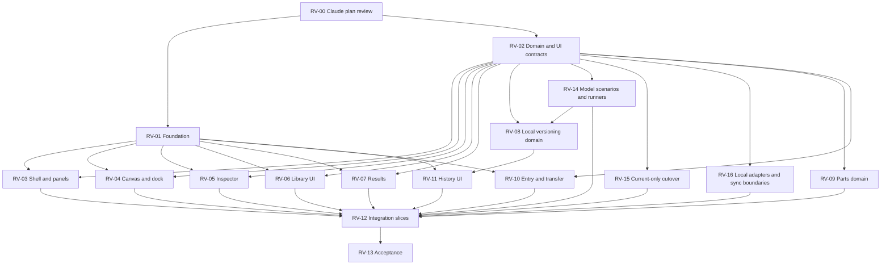

# Delivery plan and ownership

Execution hold: the user decisions from ARCH-01 are recorded, but RV-00 must review the expanded model semantics, retirement and sync boundaries before implementation. RV-14/15/16 below add explicit model-run, retirement and local-adapter work. No hosted service or live coediting implementation is authorized by these packages.

Codex is lead/planner/final verifier. Claude reviews plans, contracts and implementation. Gemini/agy performs implementation and integration edits. Cross-platform starts require the user's switch; the table is a plan, not a claim that agents were dispatched.

R15/D22 applies to RV-00, RV-02 and RV-16: review future canvas-based AI collaboration seams in `ai-collaboration.md`. Require shared validated domain commands, stable revision-aware references and structured decision/proposal/evidence extension points. Do not create an AI execution package or install AI dependencies now.

## Gates and parallel waves

Run at most three implementation lanes at once, on isolated branches/worktrees. Suggested early lanes after contracts/foundation: shell/panels, canvas/dock, versioning domain. While versioning takes time, completed lanes can take inspector, library presentation, results or exporters. Review completed slices continuously; don't wait for the entire product. UI built against fixtures remains REVIEWABLE, not DONE, until integrated with real state.

## Bounded work packages

Every path below is an ownership boundary proposal. Before READY, record exact files in the task ledger; no globs granting ownership of an entire shared subsystem. Existing files not listed are read-only. New tests belong to the task that introduces the behavior.

### RV-00 — Senior plan review

- Owner: Claude, read-only review; Codex records decisions/updates planning docs.
- Input: this plan, full source ZIP, decisions, HANDOFF and current source anchors.
- Output: severity-ranked findings with requirement/screen/code evidence; review S01–S05 semantics, old-code retirement, deployment independence, component boundaries, run identity, merge semantics and task split.
- Exit: no unresolved critical/high architecture or data-loss finding. This is READY now.

### RV-01 — Foundation and design specimen

- Owner: Gemini; Claude reviews before consumers migrate.
- Owns: `components.json`, `src/styles.css`, `src/components/ui/` exact inventory, new `src/components/studio/` shared primitives, foundation specimen/tests; package/lock/font imports only while holding shared dependency lock.
- Dependencies: RV-00; D02/D07/D08/D13 confirmed.
- Deliver: semantic tokens, font/mark/icon mapping, vetted missing shadcn components, layered native styles, full state specimens and overlay stack policy.
- Exit: R02/R11; component/browser checks and build; compare to foundation canvas. No domain behavior edits.

### RV-02 — Executable contracts and current schema

- Owner: Codex authors specification; Claude reviews. Gemini may produce bounded read-only fixture-size/compatibility evidence.
- Owns: new contract specification and fixture descriptions under `specs/revamp/contracts/`; actual shared TypeScript contract creation is a later Gemini task with an exact file list.
- Dependencies: RV-00; all D09–D14 settled.
- Deliver: concrete system/view/behavior/scenario types, typed ports and structural relationships, S01–S05 fixtures, state transition tables, numeric limits, current portable/storage versions, run fingerprints, command/panel API, parts rules, merge cases and recovery policy. No old-data migration requirement. Freeze typed contracts before RV-14/15/16 proceed.
- Exit: no unresolved storage/interaction/execution contract before related implementation starts. Contract review is not satisfied by the high-level architecture alone. Required scenario coverage must be non-empty; incomplete work stays in autosave/checkpoints.

### RV-03 — Shell, command palette and panel host

- Owner: Gemini; owns new `features/workspace/` files, `TopBar.tsx`, `ActivityRail.tsx`, shell-specific tests; excludes App/global CSS/editor.
- Dependencies: accepted RV-01/02.
- Deliver: project/branch adapters, real command availability, dock/float/stack/collapse host, bounds/preferences and keyboard/touch placement. Screens 22A nav, 13A/B, 14A, 18A, 23A–G.
- Exit: R03/R04/R11, placement reducer tests and focused browser fixtures including reload/viewport change. Integrator wires project/branch saves.

### RV-04 — Canvas appearance and customizable dock

- Owner: Gemini; owns `ArchitectureCanvas.tsx`, `SubsystemNode.tsx`, `TrafficEdge.tsx`, `CanvasNotes.tsx`, `CanvasContextMenu.tsx`, `DiagramOrganization.tsx`, `layout/CanvasFloatingDock.tsx`, associated dedicated canvas CSS/tests.
- Dependencies: accepted RV-01/02; no concurrent writer to these files.
- Deliver: 2A workspace/16A–D visual treatment and dock customization through workspace command/preferences contracts.
- Exit: R05/R11 plus notes/group/export/viewport regression journeys. No engine or editor changes outside a separately assigned integration patch.

### RV-05 — Transactional inspector

- Owner: Gemini; owns current `OpenInspector.tsx`, `OpenConnectionEditor.tsx`, `OpenWorkloadControls.tsx`, `NumberField.tsx`, `SubsystemsPanel.tsx` and new typed behavior/scenario form files after exact inventory. Legacy Inspector/ServiceModelEditor/JobControls/RoutingPanel are RV-15-owned; do not modernize code scheduled for retirement.
- Dependencies: RV-01/02; shared atomic editor API supplied by RV-12 integration task, not independently edited here.
- Deliver: draft/validation/Apply/Cancel for configuration surfaces; measured section; dirty-navigation coordination.
- Exit: R06/R11/R13, no partial mutation, one-step undo, stale-target detection, scenario-specific fields and truthful readiness. Notes retain explicit apply behavior.

### RV-06 — Library presentation

- Owner: Gemini; owns new `features/library/` UI and tests only.
- Dependencies: RV-01/02; can proceed with deterministic fixtures while RV-09 develops domain.
- Deliver: same library from dock/panel; search/list/grid/details, empty/error states and save/place controls. Screens 12A–C/16E.
- Exit: R07/R11 against fixtures; final acceptance requires RV-09 and real integration, not hard-coded counts.

### RV-07 — Results presentation

- Owner: Gemini; owns `layout/ResultsStrip.tsx`, `OpenMetricsPanel.tsx`, `ResultsPanel.tsx`, new `features/results/` adapters/tests.
- Dependencies: RV-01/02.
- Deliver: compact/expanded states, General/Components views, provenance and comparability, truthful unavailable states. Preserve saved-run operations.
- Exit: R09/R11; same model produces unchanged numeric results; partial/completed/imported states tested. No kernel instrumentation or made-up ranking.

### RV-08 — Local versioning domain and persistence

- Owner: Gemini in sequential microtasks; Claude adversarial review at each subgate; Codex verifies.
- Owns: new `domain/versioning/`, new versioning repository files and tests. Existing `domain/model.ts`, `persistence/projects.ts`, `state/editor.ts` are integration-owned and patched only in reserved RV-12 slots.
- Dependencies: accepted RV-02; RV-14 run identity API (fixtures may precede completed runner).
- Sequence: immutable snapshots/run identity → branch working copies → typed diff/merge → candidate run eligibility → transactional publish/undo → current-format validation. Each subtask gets its own exact files/fixtures/checkpoint.
- Exit: R08, deterministic three-way cases, completed-scenario gating, failure atomicity, stale-head/quota/multi-tab cases. Do not hand the junior engineer this entire track as one unbounded prompt.

### RV-09 — Saved-part domain

- Owner: Gemini; owns new `domain/parts/`, part repository files and tests, excluding shared persistence configuration.
- Dependencies: RV-02.
- Deliver: validated capture, detached clone/remapping, local part versions and one-operation insertion payload.
- Exit: R07; verify independent copies, excluded external links, collisions, notes/subsystems, limits and failed placement leaves state unchanged.

### RV-10 — Entry, CSV and Mermaid

- Owner: Gemini; owns new entry components/exporter modules/tests and `ExamplesPanel.tsx`, `DiagramExport.tsx` when reserved.
- Dependencies: RV-01/02.
- Deliver: approved template/manual/import entry; CSV run export, explicitly lossy Mermaid diagram export; preserve SVG/PNG/JSON actions. No AI/share/team controls pretending to work.
- Exit: R10/R11; escaping, formula-injection defense, Unicode/long names, graph modes and empty measurements. Export format changes remain in the shared migration task.

### RV-11 — History, commit and merge UI

- Owner: Gemini; owns new `features/history/`, `RevisionsPanel.tsx`, history tests; `StudioMenu.tsx` replacement/removal through RV-12.
- Dependencies: RV-01/02 and stable RV-08 APIs; fixtures may precede domain completion.
- Deliver: 22A–F history/commit/publish/conflict views, autosave/checkpoint distinction, exact-state scenario evidence and local attribution. No diagram exemption.
- Exit: R08/R11 end-to-end, no misleading verified/team labels, keyboard conflict resolution, cancelled/failed publish preserves state.

### RV-12 — Serialized integration slices

- Owner: Gemini integration assignment; Claude reviews; Codex validates.
- Owns exclusively: `App.tsx`, `state/editor.ts`, `domain/model.ts`, `persistence/projects.ts`, `StudioMenu.tsx`, shared CSS/contract/dependency edits when explicitly reserved, relevant integration tests.
- Integrate foundation first, then shell/canvas, inspector, library, results/entry, versioning. Each slice must build and keep existing behaviors reachable; don't integrate incomplete mutation paths.
- Exit: actual state wired, current-only cutover tested, obsolete UI removed, no duplicated commands or fake fixtures in production. Merge conflict resolution is reviewed as new code.

### RV-13 — Release acceptance

- Owner: Codex verification; Claude independent senior review; Gemini fixes only assigned findings.
- Dependencies: integrated packages.
- Deliver: full verification matrix, S01–S05 fixtures, reference captures, known limitations and current storage/recovery evidence.
- Exit: R01–R15 current-scope criteria satisfied, no critical/high unresolved findings, explicit disposition for remaining issues, clean worktree/checkpoint. R15 verifies extensible boundaries, not an implemented buddy. No deployment or push implied.

### RV-14 — Model-based execution slices

- Owner: Gemini under Codex contracts; Claude reviews every semantic slice. Owns new scenario/behavior/compiler/runner modules and focused tests, exact paths frozen in RV-02. Existing open kernel modifications require an explicit exclusive subtask; no UI worker owns kernel files.
- Dependencies: RV-00/02. Retained engine behavior is first characterized and reused, not rewritten wholesale.
- Sequence: typed scenario inputs/readiness → trace/run envelope → frontend state/event behavior (S01) → service mapping/timed resource adapter (S02) → declarative data operations (S03) → deployment/failure constraints (S04) → composed/refined end-to-end scenario (S05). Reviewer may reorder independent slices after interface freeze.
- Exit: deterministic success/failure fixtures in all five cases; limits/cancellation/truncation explicit; no fabricated timing; no collapse-dependent execution; exact fingerprints and completion evidence available to RV-08. Actual code execution remains deferred.

### RV-15 — Legacy retirement and storage cutover

- Owner: Gemini; Claude reviews source reachability and deleted behavior. Owns obsolete `MetricsPanel.tsx`, legacy Inspector/internals/control families and legacy engine files after exact manifest; shares no files concurrently with RV-05. Existing model/editor/persistence/worker dispatch edits are reserved RV-12 integration slots.
- Dependencies: RV-02 current schema; current examples and retained behavior replacements ready before removing their dependencies.
- Sequence: verified orphan cleanup → current-only constructors/examples → storage namespace/unsupported-version handling → startup/dispatch cutover → obsolete UI/engines/codecs/tests/styles removal.
- Exit: current capabilities tested, unsupported old formats clearly rejected, old database not silently erased, no legacy worker startup and no required archive viewer/converter. Document why each retired test no longer represents a product requirement.

### RV-16 — Local adapters with future sync boundaries

- Owner: Gemini; owns new local repository/run/artifact/preference adapter files and contract tests. Shared Dexie boot/config/serialization changes occur only in RV-12 slots.
- Dependencies: RV-02.
- Deliver: provider-independent current document IDs, revision-aware local transactions, separate run artifacts/preferences and author provenance. Record future GitHub/server outbox/expected-head protocol; do not build remote infrastructure now.
- Exit: local operation needs no remote service; portable model has no credentials/vendor IDs; adapter tests cover save failure and stale writes. Future hosted/self-hosted and live coediting are separately scoped delivery tracks.

## Review budget and stop rules

Prefer one component family or one domain operation per implementation checkpoint. Stop and escalate when a task needs files outside its boundary, the contract is ambiguous, a migration loses information, or a test exposes an architecture issue. Keep useful unaffected work moving. Do not add a new milestone after these requirements are accepted.
