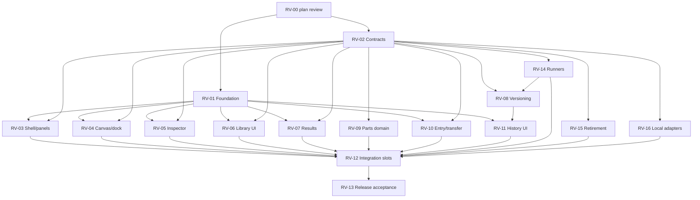

# Delivery plan

## Status

**Hold lifted (user, 2026-09-23, `/delegate start revamp work`).** EXEC-PREFLIGHT passed; first lanes RV-01a and RV-02a are in review. The hold was set 2026-09-22.

Planning is complete: the plan passed four review rounds and every RV-02 contract finding is closed ([reviews.md](reviews.md)). The only remaining step is the user reviewing the plan and lifting the hold.

## Roles and rules

| Role | Who | Does |
|---|---|---|
| Lead | Codex | Plans, assigns bounded tasks, verifies, accepts. Sole writer of this ledger, HANDOFF and ACTION_LOG. |
| Reviewer | Claude | Reviews plans, contracts and every implementation diff. Doesn't implement fixes. |
| Implementer | Gemini/agy | Implements one bounded checkpoint at a time. |

- **Dispatch** uses the `/delegate` skill with this project's roles: Claude as critic and reviewer, Gemini as executor. Record the actual prompt, output, exit status and diff; a process exiting 0 isn't proof of work.
- **Before the first write dispatch** (EXEC-PREFLIGHT): Gemini does a no-edit run that acknowledges its file boundary. Confirm the allowed writes and test commands, and rehearse an interrupt/timeout. The earlier headless attempt that exited 0 with a permission denial doesn't count. No blanket permission bypasses.
- **One task = one checkpoint.** Each task records its base commit, worktree, exact allowed files (including tests), contract sections, fixtures, requirement IDs, screens, acceptance commands and stop conditions. Stop and escalate if a task needs files outside its list or hits an ambiguity; never invent semantics. "Implement RV-14" is not a valid task.
- **Lanes.** At most 3 implementation lanes, each in an isolated worktree with its own dependency install (never symlinked). Shared contracts come before consumers; kernel patches are exclusive.
- **Shared files have one writer at a time.** `src/App.tsx`, `src/state/editor.ts`, `src/domain/model.ts`, `src/persistence/projects.ts`, `src/components/StudioMenu.tsx`, and any reserved shared CSS, contract or package files change only in a reserved RV-12 integration slot. There is one slot at a time, holding an exact file subset; it is released explicitly when accepted.
- **Interruption.** Keep ownership and the partial diff and inspect them before retrying. Never auto-reset a worktree. Retry only the unaccepted scope.
- **Acceptance** needs Claude's review of the actual diff and test output, plus Codex verification. UI built on fixtures is *reviewable*, not integrated, until it runs on real state. A change to an accepted contract invalidates the tasks that depend on it.

## Dependency graph

Suggested first lanes once the hold lifts, and only on disjoint files: (1) foundation, (2) shared schema/validators, then pure runners, (3) repository base (RV-16a).

## Packages

| ID | Owner | Scope (owns) | Needs | Done when |
|---|---|---|---|---|
| RV-00 | Claude | Plan review | — | **Accepted** |
| RV-01 | Gemini | `components.json`, `src/styles.css`, exact `components/ui/` files, new `components/studio/`, specimen + tests; package/fonts only while holding the dependency lock | RV-00 | R02/R11; component/browser checks; matches the foundation canvas. No domain edits. |
| RV-02 | Codex / Claude | [contracts/](contracts/README.md) | RV-00 | **All findings closed**; shared TypeScript types are a later Gemini task |
| RV-03 | Gemini | New `features/workspace/`, `TopBar.tsx`, `ActivityRail.tsx`, shell tests | 01, 02 | R03/R04/R11; reducer tests; screens 22A nav, 13A/B, 14A, 18A, 23A–G; reload/viewport |
| RV-04 | Gemini | `ArchitectureCanvas`, `SubsystemNode`, `TrafficEdge`, `CanvasNotes`, `CanvasContextMenu`, `DiagramOrganization`, `layout/CanvasFloatingDock` + canvas CSS/tests | 01, 02 | R05/R11; notes/group/export/viewport journeys; 2A, 16A–D. No engine/editor edits. |
| RV-05 | Gemini | `OpenInspector`, `OpenConnectionEditor`, `OpenWorkloadControls`, `NumberField`, `SubsystemsPanel`, new typed forms | 01, 02; editor API via RV-12 | R06/R11/R13: no partial mutation, one undo, stale detection, truthful readiness |
| RV-06 | Gemini | New `features/library/` | 01, 02 (fixtures OK) | R07/R11; final acceptance needs RV-09 + integration; screens 12A–C, 16E |
| RV-07 | Gemini | `ResultsStrip`, `OpenMetricsPanel`, `ResultsPanel`, new `features/results/` | 01, 02 | R09/R11; identical numbers for the same model; partial/completed/imported states. No kernel instrumentation. |
| RV-08 | Gemini (sub-steps) | New `domain/versioning/` + repository files | 02, RV-14a, RV-16a | R08; see sub-steps below |
| RV-09 | Gemini | New `domain/parts/` + part repository | 02 | R07/R11: independent copies, exclusions, collisions, limits, failed placement leaves state unchanged |
| RV-10 | Gemini | Entry components, exporters, `ExamplesPanel`, `DiagramExport` (when reserved) | 01, 02 | R10/R11: escaping, formula safety, Unicode, empty data; keep SVG/PNG/JSON |
| RV-11 | Gemini | New `features/history/`, `RevisionsPanel`, tests (`StudioMenu` via RV-12) | 01, 02, RV-08 APIs | R08/R11: 22A–F; no false verified/team labels; keyboard conflict resolution; failed publish keeps state |
| RV-12 | Gemini | Shared files, one slot at a time | Accepted features | Real state wired; cutover tested; old UI removed; no duplicate commands or fixtures in production |
| RV-13 | Codex / Claude | Release verification | All, incl. RV-14 S01–S05 | [Release gates](verification.md#release-gates) |
| RV-14 | Gemini (sub-steps) | New scenario/behavior/compiler/runner modules; kernel only via exclusive sub-step | 02 | R13: S01–S05 success/failure; limits, cancellation and truncation explicit; fingerprints available to RV-08 |
| RV-15 | Gemini | `MetricsPanel`, legacy Inspector/internals/controls, legacy engines, per the manifest ([architecture §6](architecture.md#6-legacy-retirement)) | 02; replacements accepted | Unsupported formats rejected; old DB untouched; no legacy worker; each retired test justified |
| RV-16 | Gemini (sub-steps) | New local repository/run/artifact/preference adapters; Dexie boot only via RV-12 | 02 | R14: works offline; no credentials or vendor IDs; save-failure and stale-write tests. No remote code. |

Ownership notes:
- **RV-05 vs RV-15.** RV-05 owns `OpenInspector`; RV-15 owns the legacy `Inspector` and never modernizes code scheduled for retirement. A file moves to retirement only after its replacement is accepted.
- **Kernel files.** No UI task owns them.
- **Retirement edits.** RV-15 writes the deletion manifest; the serialized edits happen in RV-12 slots.

### Sub-steps

| Step | Needs | Delivers |
|---|---|---|
| RV-14a | RV-02 | Scenario readiness, canonical manifest, evidence interface, trace envelope |
| RV-14b | 14a | S01 machine interpreter |
| RV-14c | 14a | S03 data operations (parallel with 14b) |
| RV-14d | 14a | Retained-kernel characterization, finite-input/trace adapter, S02 outcomes |
| RV-14e | 14d **accepted** | S04 fault scheduler with exact failure accounting |
| RV-14f | 14b–e | S05 composition/refinement; five-family acceptance |
| RV-16a | RV-02 | New namespace, immutable rows, compare-and-set/receipts, preferences, quota/recovery, repository port |
| RV-16b | 16a, RV-08 history, RV-14 evidence | Import/export, pruning, recovery journeys |
| RV-08a | RV-14a, RV-16a (pure logic can use a port fake; durable acceptance needs 16a) | Snapshot/evidence storage, eligibility predicates |
| RV-08b | 08a | Branch working copies, autosave/checkpoints, switch/save-failure |
| RV-08c | 08b | Typed three-way diff/merge, reference conflicts |
| RV-08d | 08c, RV-14a–f all accepted | Isolated candidate runs; eligibility across all five families |
| RV-08e | 08d, RV-16a | Atomic publish, default closure/reopen, stale-head cases |
| RV-08f | 08e | History round trip, retention/reference integrity |

RV-14d and RV-14e are always serialized. RV-16b follows versioning integration, which avoids a dependency cycle.

**Integration order:** foundation → shell/canvas → inspector → library/results/entry → history. The current-schema, runner and retirement slices are coordinated before incompatible consumers are wired in.

## Task ledger

| ID | Status | Next |
|---|---|---|
| PLAN, RV-00, RV-02 | ACCEPTED (planning) | — |
| EXEC-PREFLIGHT | ACCEPTED 2026-09-23 | agy runs headless with `--dangerously-skip-permissions` (user choice) inside per-task worktrees; timeouts need a SIGTERM/SIGKILL watchdog (`alarm`/`--print-timeout` don't stop agy) |
| RV-01 foundation (a–h) | ACCEPTED (Claude sign-off 2026-09-23) | Branch `claude/rv-01a-tokens` @ `3631027`. RV-01h matched Button/fields/checkbox/tabs/toggle-group/tooltip/menus/tags/kbd to the Design System board (computed-style check). Residual (low): primary button text white vs board shell #FBFAF7; field 'filled' white state needs a placeholder; Button loading+asChild shows no spinner; toast has no layering token (contract gap); existing screens inherit the new primitive looks and are restyled in their own packages. Unblocks RV-03/04/05/06/07/10/11 UI work |
| RV-02a–g model core | REVIEW PASS, committed | Head `claude/rv-02g-manifest` @ `2ffa2d3`: D32/D33 applied to the validator; `buildManifest` + `ss-run-v1` fingerprint (Claude probes: presentation/reorder stable, latency/seed change it, other scenario isolated, no labels in manifest). Open gap: are scenario `entryPorts` a set (sorted) or ordered? |
| RV-05a inspector restyle (visual) | REVIEW PASS, committed | `a97836b` on foundation line. Apply/Cancel waits for RV-12; App.tsx wrapper 340px vs inspector 320px leaves a sliver (RV-12) |
| RV-04c nodes/edges/boundaries | REVIEW PASS, committed | `76e4a37`, merged on foundation line @ `8e869e5`: 176px cards with D35 kind stripes, wrapping titles/subtitles, legacy node card CSS removed (no !important). Drop-preview/dimmed node states not wired (need canvas data, later RV-04 slice) |
| RV-03a panel reducer | REVIEW PASS, committed | `claude/rv-03a-panel-reducer` @ `e9e3b58` (pure, 55 tests). Gaps: gesture payloads, activeOverlay representation, announce wording |
| RV-03b top bar + rail (22A) | REVIEW PASS, committed | `fe2bda7`, merged on `claude/rv-01a-tokens` @ `2262d55`. Temporary `header.canvas-first-topbar { z-index:1100 }` keeps the top bar above the RV-12-reserved StudioMenu backdrop (remove when StudioMenu becomes a DropdownMenu). Rail label clipping fixed in RV-03c `a1af2bd` (board short labels, full aria-labels; supplied 22A app mark) |
| RV-04a canvas dock (16A) | REVIEW PASS, committed | `c7a4020`, on foundation line. 16B overflow actions not in app (not invented); arbitrary shadow until elevation tokens exist; RV-04b `9fc4367`: 'More canvas tools' overflow popover on narrow screens (16B) and raised/popover/floating shadow tokens. Foundation line now `11b6bb0` |
| RV-02f remaining readiness rejects | REVIEW PASS, committed | `claude/rv-02f-readiness` @ `e75fc15`. 'Missing pipeline outputs' read as unresolvable output/error port (S03 shows unconnected outputs are legal) — contract round to confirm |
| RV-12a layout slot (App.tsx, StudioMenu.tsx, canvasFirst.css) | REVIEW PASS, committed; slot released | `5a93acf`, merged on foundation line @ `b4e73ca`: inspector dock 320px + 1px border (sliver gone), StudioMenu backdrop starts below the measured top bar (temporary z-index 1100 rule removed), mobile canvas fills remaining height. Production e2e 72/1/4 (was 68/5/4); remaining failure is the 40px Load-example target. Debt: `.system-canvas` mobile anchor uses `!important` to beat legacy `openWorkspace.css` (clean up when that file retires) |
| RV-07a results strip + metrics detail (visual) | REVIEW PASS, committed | `66885b1`, merged on foundation line @ `aa281c1`: text run-state badge, tabular numbers with units, General/Components sections (not tabs — both always shown), phone stacking. Three review rounds (fake tabs, unit on empty value, arbitrary sizes; mobile strip hid all stats). Production e2e 78/1/4. `ResultsPanel` (saved-run comparison) not restyled yet. Observed: the same example yields different numbers per run (e.g. 97.4 vs 100.4 req/s) — pre-existing, relevant to R09 'identical numbers' and RV-14 seeding |
| RV-12b runner-line merge (package.json, package-lock.json) | REVIEW PASS, committed; slot released | Merge `e7dd0f9` on the UI line (`claude/rv-01a-tokens`) of the runner line @ `7ef2e39` (RV-14, RV-16a/b, RV-08). Only package files overlapped (auto-merged: `fake-indexeddb` dev dependency next to the UI line's packages; `npm ci` clean). 881 unit, tsc, build pass; production e2e 76 passed / 1 known failure (diagram.spec.ts:260) / 4 skipped. The suite has 81 tests on both sides, so the earlier "78 passed" baseline was a miscount. No application wiring: the editor, canvas and saves still use the legacy `Graph`/`system-studio` path. The cutover needs a Document-native editor API first (RV-05 depends on it "via RV-12") |
| RV-12c clean cutover (D37) | DONE (c1, c2, c4 accepted; c3 delivered as RV-10b/RV-12i; c5 superseded) | Steps, each its own review: **c1** headless session layer in new `src/features/session/` (boot `system-studio-local-v1`, create/open/rename project, branch envelope + `model.apply-records`, serialized save queue with no optimistic display, session undo/redo ≤100 as new CAS commands, stale handling); **c2** new app shell replacing `App.tsx`/`main.tsx` on the session (restyled TopBar/Rail/Dock, canvas projecting Document views; add/move/connect intents), legacy UI, editor, persistence and their tests deleted; **c3** new project (blank + templates from reference fixtures), v9 import/export; **c4** run through the runner (worker) with results. Then RV-05 typed inspector, RV-07 results, RV-11 history, RV-06 library build on the session |
| RV-12c1 headless session layer | ACCEPTED (user 2026-09-24) | `ebd769d` (Gemini), merged on UI line @ `7849215`. New `src/features/session/`: `openStudioRepository` (required mintId, typed unavailable/quota), `SessionController` (required repository/mintId/actor; create/open/rename; one in-flight operation → `busy`, `loading`/`saving` status; document + workingRevision adopted as a pair from the reloaded branch; reload failure → `missing` + `needsReload` blocks edits until reopen; typed inverse changes; undo/redo ≤100 as new CAS commands, cleared on open). 909 unit, tsc clean. Review round: invented blank document and revision/document fallbacks, silent inverse skips, duplicate undo fields, unguarded open, optional boot mintId; Claude removed an unused `now` option. Gap: empty undo/redo returns `{status:'empty'}` (no command) |
| RV-12c2 new app shell + legacy deletion | ACCEPTED (user 2026-09-25) | `c7a5a12` (Gemini), merged on UI line @ `5d1836b` (136 files, −19.7k lines). Boot on `system-studio-local-v1` (typed failure + Retry); entry (2A new system): project list with explicit per-branch Open from `loadHistory`, blank project (named, no views), S01–S05 examples from `specs/revamp/fixtures`; workspace: top bar (rename, save status, undo/redo, Mod+Z/Mod+Shift+Z), Library/History rail items disabled, canvas projecting the active view (placement-ID nodes, call/message/data edges, groups, notes, projection issues notice, fit on open/view switch only), drag = one view replace = one undo, dock with local camera (1.2×, clamp 0.1–2, 32 px fit), runs disabled. Repository gains read-only `listProjects()`. Legacy UI/editor/persistence/workers and their unit + 23 e2e specs deleted; open kernel + goldens kept. 767 unit, tsc, build; production e2e 2 passed / 4 skipped (specimen dev-only). Review rounds: first-open-branch heuristic + swallowed error, raw exception text, auto-flip to workspace, element-ID node identity, width/label fallbacks, invented stripe layers, 24 `text-secondary` (background colour) text uses, blank icon buttons, no initial fit, mobile dock clipping, connectable-looking handles. Debt: edge labels overlap on tight fixture layouts; phone dock wraps to 3 rows; `styles.css` still carries legacy rules and new `!important` edge-label overrides; legacy `domain/model.ts` kept only for types the kernel uses (pulls results/subsystems/notes/revisions); bundle 888 kB. Open: D35 stripe layer for state-machine/data-pipeline/host (neutral until decided); add/delete/connect need contracted element/connection constructors |
| RV-12c4 runs in the new app | REVIEW PASS, committed | `579cb4e`, merged on UI line @ `30c24d8` (823 unit). Gemini built it; review round started by Gemini (quota hit mid-round) and finished by Sonnet. `src/features/runs/`: worker protocol (opaque single-use plans, bounded stepping, pause/resume/cancel, one sanitized terminal), RunController (required mintId, start tokens, saveRun, run all, retry save, reset, `measured` flag), derived status incl. `not-ready`, ScenarioRunControl, ResultsRegion. Review round: randomUUID default, logical-mode default, fabricated zero summaries shown as results, raw element IDs, casts, missing not-ready. No component render tests (no jsdom); covered by RV-12d e2e |
| RV-03s shell per screens | REVIEW PASS, committed | `cd96b8a` (Sonnet), merged on UI line @ `06c8e71`. 22A top bar (breadcrumb chip, 13A project menu: rename + All projects, 13B branch popover from loadHistory, `runControl` slot), rail removed, 16A labelled dock with zoom %, 2A node cards (icon map, D42 stripes/captions, "Not simulated"), smoothstep edges + label chips above nodes, open-fit capped at 100% (Fit button 0.1–2), 2A two-column entry (no prompt/import). Session: D40 auto-draft ("Draft from main" + first free suffix), `workingSnapshotId`/`mainBranchId`. 788 unit, tsc, build, production e2e 2/4 skipped (specimen). Review round: 161% open zoom, curved edges hiding labels, D42 stripes/captions. Debt: label chips overlap caption starts on tightly spaced fixtures; Quick options/History/… absent until built |
| D39 catalog contract | ACCEPTED (user 2026-09-25, D42) | [contracts/catalog.md](contracts/catalog.md) (Sonnet, one review round: resource entry ports, per-route port counts, worker inbound channel). 12 open questions in §6. Then library/add/Connect |
| RV-12d integration slot | REVIEW PASS, committed; slot released | `70d4bd7`, merged @ `c94f694`. Sonnet (one rate-limit interruption, resumed), merged on UI line. Runs wired: RunController per session over a module worker, ScenarioRunControl in the top bar (per-browser selection), Run/Run all/Pause/Resume/Reset, statuses recomputed after edits/saved runs, ResultsRegion below the canvas (assertion labels, event log, 'Ran on an earlier version'), hidden without scenarios; scenario editing actions disabled until the inspector; overlapping edge-label chips shown on hover/selection. 848 unit, tsc, build, production e2e 6 passed / 4 skipped (specimen). Review round: raw assertion IDs, empty event log, chip over captions, randomUUID default, placeholder mode, truncated labels |
| RV-06a catalog domain module | REVIEW PASS, committed | Gemini, merged on UI line; no review fixes. `src/features/catalog/`: 32 entries per D42, `placeEntry`, `planConnection`/`completeConnection`, library caption/defaults line; 857 unit. Lead readings to confirm: a placed state machine gets one state "initial" and an empty context fixture (the validator requires an initial state); a new connection's label defaults to its kind ("call"/"message"/"data", label is required); an `{elementId}` target resolves to its entry port (resource) or first matching inbound port |
| RV-05b inspector + drafts | REVIEW PASS, committed | `21557df` (Sonnet), merged on UI line @ `744cb18` (950 unit). Draft model per commands §6, element/connection fields with validator bounds, read-only machine/pipeline/decision/host, MEASURED · LAST RUN (available metrics only), navigation guard, Run disabled while dirty (D25 reason), 70vh mobile sheet. Production e2e 8/4 skipped. Review round: blank close icon, revision fallback after apply, full-height mobile sheet hiding Apply, unreadable mobile breadcrumb. Gaps: mixed-kind multi-select replaces selection; a failed Apply from the guard keeps the inspector open |
| RV-06b library components | REVIEW PASS, committed | `2b7487d` (Gemini; Claude de-duplicated the unmodeled caption), merged on UI line. LibraryPanel (12A/B/C) and LibraryPicker (16E) over the D42 catalog, Standard only, excluded elements absent, drag payload `application/x-studio-catalog-entry`, keyboard/touch; `LibraryPreview` harness. Filter chips use catalog groups (Recent/Patterns/team chips excluded). Wired through RV-12h. DEFAULTS raw-key debt closed by `a388433` / UI merge `12f3cb9`: Library and inspector share human-readable field/option copy; 1246 unit, tsc, build, production e2e 26 passed / 4 skipped |
| RV-10a transfer module | REVIEW PASS, committed | `d2e312b` (Gemini; Claude removed one fallback), merged on UI line @ `104f0bb` (999 unit). JSON export (canonical repository bytes) / import (byte cap, v7/v8 → D19 message, validation, atomic, repository's own FileToken registry), SVG (deterministic, escaped), PNG (bounded, injected canvas), Mermaid v1, CSV v1 (labels from the run's snapshot, one row per summary metric, formula defence), limitation texts. Review round: fresh FileToken registry behind a cast, blank scenario IDs, labels from outside the run, zero-filled counts. Not wired into menus yet |
| RV-12e place, connect, delete | REVIEW PASS, committed | `02606c2` (Sonnet, resumed from an interrupted Sonnet pass), merged on UI line @ `ef885e5`. Dock Component → 16E picker (place at centre or drag onto canvas), Connect tool with the resource form (request class, read/write with no preselection, deadline with no default) and route ports, Delete with a scenario-dependency preview; each one undoable session command. D43(a): blank projects get one empty view "Main". Fixed a stale-document lookup that showed a just-placed record as deleted. 1114 unit (load timeouts only; affected files pass alone), tsc, build, production e2e 12 passed / 4 skipped. Review rounds: model/validate edits without the D43 text (reverted), hex colour fallback, node data casts, invented rejection texts, preselected operation. Gap: D43(b) request-class label not stored — the form's class text is validation-only and each connection mints a new class ID (RV-12f). Full library panel waits for panel docking |
| RV-03p panel system | REVIEW PASS, committed | Gemini, merged on UI line with the RV-03a reducer; no review fixes. `src/features/panels/`: PanelHost (docks, two-panel stacks, floating, rails with peek), 23A header menu, drag with drop targets and cancel, clamped keyboard resize, §7 breakpoints, preview harness. Gaps: unseen-changes dot is a prop (reducer doesn't track it); no menu shortcut hints (none contracted). Not wired yet |
| RV-11a history ladder + commit | REVIEW PASS, committed | `c3f49df` (Gemini build; Sonnet finished after Gemini quota), merged on UI line @ `a891c5a`. Self-contained `src/features/history/`: HistoryController (checkpoint, restore with a required user-entered pre-restore checkpoint label, commit with one evidence ref per scenario from the latest qualifying run; rejects main and zero scenarios), HistoryLadder (22A/22B), CommitPanel (scenario_commit_gate). Review round: invented branch name 'main', restore label 'Pre-restore checkpoint', 'Unlabelled' and 'readiness check failed' fallbacks, raw fixture/refinement IDs as labels (now kind + linked schema/owner label). Wired through RV-12h. Raw amber debt closed by `57cfe4b` / UI merge `0d54aef`: semantic warning roles cover modified/needs-rerun History states and Badge/Alert primitives; 1250 unit, tsc, build, production e2e 26 passed / 4 skipped. Publish/merge (22C–F) = RV-11b |
| RV-11b publish review + conflicts | REVIEW PASS, committed | `387765a` (Sonnet first pass `f5e852c`; review round interrupted by the Sonnet limit and finished by Codex `943761e`; Claude fixes), merged on UI line @ `469dd52`. `src/features/history/`: PublishController over CandidateController (prepare, resolve → new candidate, evaluate, candidate runs via an injected run function, publish), PublishReviewDialog (22C: five numbered sections, version radios with nothing preselected, inline blocking reason, explicit irreversible confirm), PublishedNotice (22D, no Undo publish), DraftBehindMainBanner (22E, exported, not wired), CompareAndResolvePanel (22F: unresolved/auto-merged/unchanged lists, field-level use ours/theirs/edit with typed scalar edits, reopen, progress, Apply and run; fields named by the inspector's labels). 1174 unit, tsc, build, production e2e 17 passed / 4 skipped. Review rounds: built first without the screens (JSON-textarea edit, no dialog), invented error fallbacks, casts; then plural, step marker, raw config paths. Checked visually from static renders against 22C/22F. Note: the domain's ours = main head, theirs = draft (RV-08d); the UI names both sides by branch, so the screen's reversed wording is only labelling. Not wired into the shell |
| RV-12f D43(b) request-class labels | REVIEW PASS, committed | `aecb33f` (Codex), merged on UI line @ `10a31f2`. Required `requestClassLabel` (1–60) in model + validator (same class ID → one label per document), stripped from the manifest projection (identical fingerprints across labels; goldens unchanged), `completeConnection` takes the label, connect form offers existing classes by label (datalist) and reuses the ID on an exact match, new label → mintId. Fixtures s02/s05/combined: the two classes labelled "Order" (user 2026-09-27), measurements.json regenerated; mirrored to the docs branch. 1126 unit, tsc, build; e2e run by Claude (Codex sandbox blocks Chromium). Note: combined.json has two class IDs both labelled "Order"; the form reuses the first match. Flaky authoring e2e fixed in RV-12g |
| RV-12g authoring e2e stability | REVIEW PASS, committed (Claude, user request 2026-09-27) | `4193346`, merged on UI line @ `3d76460`. Root causes found under load were app bugs, not only test timing: (1) canvas sync rebuilt nodes without ReactFlow's `measured`, so an unchanged node could stay `visibility:hidden` with its edges gone; (2) the `fitView` prop refit the camera when an empty view got its first node; (3) ReactFlow's default Backspace removed the selected node locally even when the delete preview was cancelled (`deleteKeyCode={null}`, regression-tested). Save status exposes `data-state`. Authoring e2e rewritten: small independent tests on blank projects (S05 only for the delete preview and mobile picker), condition waits, ID-diff node identity, connect retries only after a visible no-op, no suite retries. 1126 unit, tsc, build; authoring spec 135/135 under load (4 workers × 5 repeats × 3, unit suite in parallel); full production e2e 17 passed / 4 skipped three runs in a row |
| RV-12h History + Library panels (integration slot released) | REVIEW PASS, committed | `bd9b928` (Sonnet, one review round, one rate-limit resume), merged on UI line @ `b019d1a`. PanelHost around the canvas (panel state in memory), top-bar History → HistoryLadder/CommitPanel/PublishFlow/CompareAndResolve on live controllers, behind-main banner (prepare on branch open/switch and when History/Publish opens, never per edit), Library panel from the picker's full-library link placing through CanvasView's placement path. HistoryController `subscribe`/`getState` bound (crashed as bare refs). Workspace takes the session actor from App. 1203 unit, tsc, build, production e2e 23 passed / 4 skipped. Follow-up `5966b3b` / UI merge `bcd2f2e` removed hosted duplicate headers, fixed narrow Library grid clipping and replaced "current none" with "first publication". Panel-preference debt resolved by RV-12j |
| RV-10b transfer UI | REVIEW PASS, committed | `fda898a` (Sonnet; Claude review fixes), merged on UI line @ `24b81f1`. `src/features/transfer/ui/`: ExportMenu (18B: Diagram as PNG/SVG, System as JSON, Run results as CSV, Diagram as Mermaid; each disabled with its stated reason), `createTransferActions`/`useTransferActions` over the RV-10a exporters with an injected download sink; entry screen Import a project (FileToken registry → project.import, typed messages incl. D19). App passes the session actor to EntryScreen. 1202 unit, tsc, build, production e2e 19 passed / 4 skipped (import round trip + v7 rejection). Review fixes: a second actor store with a randomUUID fallback, generic import fallback text, "Copy as Mermaid" on a download. Mounted under the project menu by `5966b3b` / UI merge `bcd2f2e`; CSV uses the displayed durably saved run and otherwise keeps `Select a saved run to export its results as CSV.` |
| RV-05c scenario editor (D41) | REVIEW PASS, committed | `0f5030a` (Sonnet, one review round, one rate-limit resume), merged on UI line @ `96a3284`. Self-contained `src/features/scenarios/`: draft lifecycle (empty timed/logical drafts prefill only budgets, seed and logical quiescent completion; copy remaps every nested ID; draft-only unset states for completion, key distribution and assertion paths block Apply with linked errors), ScenarioSwitcher, NewScenarioDialog, ScenarioEditor (timed/logical sections), DeleteScenarioDialog, ScenariosPreview; screenshots in `artifacts/rv-05c/`. 1225 unit, tsc, build, production e2e 23 passed / 4 skipped. Review round removed invented defaults (horizon 30 s, always-true boundary match, uniform/1 key distribution, whole-value assertion path). Mounted by `5966b3b` / UI merge `bcd2f2e`: ScenarioSwitcher replaces ScenarioRunControl and scenario drafts use the existing guarded inspector dock/sheet. Original Guard/path/binding/reorder gaps closed by RV-05d |
| RV-12i Export + scenario mounts and panel debt | REVIEW PASS, committed; slot released | `5966b3b` (Codex delegate plus lead completion and one review round), merged on UI line @ `bcd2f2e`. ExportMenu mounted under ProjectMenu with live transfer state; the displayed run becomes CSV-selectable only after save. ScenarioSwitcher plus New/Copy/Edit/Rename/Delete use the D41 draft helpers and ScenarioEditor in desktop/mobile inspector surfaces with Apply/Discard/Stay guarding. Hosted panel chrome de-duplicated, Library grid bounds fixed, first-publication copy corrected. 1231 unit, tsc, build, production e2e 24 passed / 4 skipped on isolated port with two workers and no retries |
| RV-12j panel preference persistence | REVIEW PASS, committed; slot released | `1529f49`, merged on UI line @ `e51dc09`. Added the singleton preference read API and Workspace persistence for panel placement/collapse/width. Only validated panel fields hydrate; unrelated dock/camera fields survive. CAS saves serialize; stale writes adopt the durable state behind an explicit display barrier and never auto-retry; failed writes roll back only the latest request and expose failed state. Floating rects clamp at render time without overwriting desktop preferences. Independent Codex review passed after two fix rounds; Claude CLI was not authenticated. 1240 unit, tsc, build, production e2e 25 passed / 4 skipped on isolated port with two workers/no retries |
| RV-05d scenario authoring completeness | REVIEW PASS, committed | `2e2e9d3`, merged on UI line @ `751d4c3`. Added recursive typed Guard/Value authoring for logical boundary responses, explicit scope-crossing source/payload/outcome/delivery choices, schema-driven request→response payload bindings, nested assertion paths including explicit list indices, and semantic step reorder by drag, Arrow keys or move buttons. Required choices stay local until complete; incomplete edits to stored guards disable Apply. Five focused unit/render checks plus production workspace e2e. Review fixed invalid guard edits leaving Apply enabled and first→second drag being a no-op. Gemini preflight produced no usable output; independent Codex critic hit its usage cap; Claude CLI was not authenticated, so Codex lead implemented and self-reviewed. 1245 unit, tsc, build, production e2e 26 passed / 4 skipped on isolated port with two workers/no retries |
| RV-03q command registry + Quick options (14A) | REVIEW PASS, committed | `9a285f3`, merged on UI line @ `247ce0d`. `src/features/workspace/commands/registry.ts`: commands.md §1 entries for the wired commands (project rename/switch, branch.switch, run start/start-all/pause/resume/reset, history/library open, the five exports, undo/redo, commands.open) with closed payloads, availability reasons and an exhaustive handler table; Mod+Z / Mod+Shift+Z / F2 route through it (IME, editable fields and dialogs ignored; preventDefault only on an enabled match). 14A dialog from a top-bar button or F2 with search, disabled reasons, current/main/closed branch badges and nested rename. §2 exclusions honoured (no ⌘-letter keys, duplicate/settings, new branch, team copy, branch ahead/behind). Not yet in the registry: selection.*, canvas tools, dock.*, parts, branch create/reopen (canvas Delete keeps its own handler) |
| RV-04e 16D selection actions + dock Note | REVIEW PASS, committed | `520f372` (Codex gpt-5.6-sol via /delegate; lead review fixed desktop dock wrapping), merged on UI line @ `46ed3dc`. Pure `selectionPlans.ts` (group/ungroup/align/distribute/add-note, one view replace = one undo, validator limits), registry ids selection.group/ungroup/align/distribute + canvas.add-note with selection-aware availability and a Selection group in Quick options (nested text step). 16D toolbar: N PARTS, Group (typed label), Ungroup, Align/Distribute menu, Delete; dock Note (typed text at visible centre). Absent: selection.duplicate, Wrap in boundary, overflow items, comment icon |
| RV-09a parts copy engine + selection.duplicate | REVIEW PASS, committed | `ab23b0b` (Codex gpt-5.6-sol via /delegate; usage limit hit at the end, lead verified completeness), merged on UI line @ `dd68c11`. Pure `src/domain/parts/`: `captureSelection` (schema/fixture/refinement closure, preview of included/excluded connections, relations, groups, notes; blocking member-without-owner, deployed-on crossing, missing fixture/schema; ≤50/100/100/50 and 512 KiB limits), `remapContent` (fresh UUID per member, typed rewrite via closed-union switches), `planPlacement` (anchor offset, full validateDocument on the would-be document, one batch = one undo). selection.duplicate in 16D + Quick options with a confirmation listing what stays behind; copy at +24/+24 becomes the selection. Remaining RV-09: saved-part repository, Library 'Save as component', part import/export, Replace part |
| RV-12c5 design conformance | SUPERSEDED by [design-revalidation.md §4](design-revalidation.md#4-plan-changes-proposed) (proposed feature packages on the new app) | — |
| RV-14a runner start | ACCEPTED (user 2026-09-24, with RV-14) | `claude/rv-14a-runner-start` @ `3d413c4` (on model line `2ffa2d3`): `src/domain/studio/runner/` — `prepareScenario` (validate → buildManifest, cancel checks between steps; no worker/plan handles/startRun yet), trace envelope (IDs, deep-frozen content-addressed payload table, independent row/byte caps with no orphan payloads, `invalid-event` rejection, RunUpdateGuard), run-update/result types, evidence interface (eligibility left to RV-08a). 389 unit, tsc clean. Gaps: `buildManifest` takes no AbortSignal (cancel only observed between steps); `identity-unavailable` has no compile status (mapped to invalid); scheduled-events/live-roots limits have no default/max pair; `TraceRecorder.append` must be awaited sequentially by callers |
| RV-14b S01 machine interpreter | ACCEPTED (user 2026-09-24, with RV-14) | `f9c4f47` (Gemini): `runner/{expr,machine,logical,assertions}.ts` — Evaluator for all Value/Guard kinds, first-match machine with atomic effects, logical runner for machine+boundary scenarios, assertion evaluation. All three S01 scenarios pass every authored assertion plus §11 trace facts; deterministic. Gaps: request ID format `${rootId}:${counter}`; `trace` effects recorded as TraceEvent kind 'state'; non-machine behaviors rejected until later RV-14 steps |
| RV-14c S03 pipeline operations | ACCEPTED (user 2026-09-24, with RV-14) | `585b6fb` (Gemini): `runner/{pipeline,schema-value}.ts` — all six operations with row provenance, exact rowOutcomes, UTF-16 key order, overflow checks, output/error schema validation; map/filter via injected Evaluator. S03 reproduced exactly. Gaps: non-validate row errors send the original row to the error output (error schema must accept it); overflow fails only the overflowing row; schema-failure result shape; a row rejected after group-sum carries the aggregate row |
| Runner line | integrated | `claude/rv-14a-runner-start` @ `59cf20b` = RV-14a + shared `expr-api.ts` (`81f8b09`) + RV-14b + RV-14c; 456 unit, tsc clean. Pipelines are not yet wired into `runLogicalScenario` (S03 runs through `runPipeline` directly) |
| RV-14d retained kernel + S02 | ACCEPTED (user 2026-09-24) | Branch `claude/rv-14d-kernel`, merged on runner line @ `422187f`. 14d-1 `a7ac303`: 20 characterization tests / 19 golden metric files (kernel unchanged; mutated golden fails). 14d-2 `470ccc6`: additive kernel hooks, stepping, finite input injection (refuses clock jumps), null-key LRU miss; `runner/resource-adapter.ts` (admit/peekNext/stepNext/snapshot, horizon/drain). 14d-3 `40261f7`: `runner/{decision,scenario-runner}.ts` — one global timed scheduler; S02 allow/deny + worker-failure + max-2-retry variants; S01/S03 end to end. 544 unit, goldens unchanged, tsc clean. Review rounds fixed: clock jump, implicit workload disabling, invented 'k-0' key, success defaulted from a null outcome, prefix-matched message linkage. Broadcast fan-out settled by D36 (one message root per delivered copy); implemented in RV-14e. interruptHost → 14e, settleCall/bridge → 14f |
| RV-14e S04 faults + D36 | ACCEPTED (user 2026-09-24, with RV-14) | `8ee3bd7`, merged on runner line @ `01cac16`. Gemini hit quota mid-task; Sonnet finished from the partial state. Kernel fault support (inert without faults; goldens unchanged), adapter validation + interruptHost + one unit-level settled event per root, D36 broadcast roots. All three S04 scenarios incl. §11 per-arrival routes; fault-free S01/S02 byte-identical to `422187f`. 559 unit, tsc clean. Review rounds fixed: router→in-kernel resource routes crashing the runner, partial §11 assertions, duplicate settled events per rejected root, invented failing of waiting retries at outage. Note: the runner schedules faults through the kernel's own heap; adapter `interruptHost` is exercised only by unit tests |
| RV-14f S05 composition | ACCEPTED (user 2026-09-24) — RV-14 complete | `24aa89f` (Sonnet; Gemini quota), merged on runner line @ `3fbf6ae`. Bridge call frames (settle once, adopt child outcome/payload, outage-while-open), user root shared across the bridge, refinement selection (aggregate/refined, coverage, invalid combos), cancellation at batch boundaries, five-family acceptance (S01–S05 together, deterministic, chunk-independent). 591 unit, goldens unchanged, tsc clean. Review rounds: journeyId 'unknown' + kernel identities leaking into trace for delivered messages (present since 14d), and every invented default removed (missing outcome/payload/context now fails the run; root vs message by kernel category, not ID shape). S02 allow message 'generated' metric corrected 0→1. Gaps: router + bridge combination not implemented; runtime refinement resolves one level of port mapping (compile-time closure does the full walk) |
| RV-16a local repository base | REVIEW PASS, committed | `48331ba` (Gemini), merged on runner line @ `590fe19` (runner line now also carries the `fake-indexeddb` dev dependency, `bd9bbe2`, user-approved). `src/persistence/studio/`: Dexie `system-studio-local-v1` v1 with the §2 schema, immutable rows, CAS, operation receipts (checked before stale), §5 error set, quota/unavailable mapping, byte + count limits before mutation, §5 port with loadProject/loadBranch/savePreferences/deleteProject and project.create / project.rename / branch.create; other methods typed-unsupported. 620 unit, tsc clean. Review round: removed repository-generated branch IDs and the rename→main fallback (explicit IDs and branch envelope required). Gap: preferences use a single key 'user' |
| RV-08a evidence storage + eligibility | ACCEPTED (user 2026-09-24, with RV-08) | `19316bc` (Gemini), merged on runner line @ `d7efb19`. Unforgeable run start tokens (module-private registry bound to project/run/snapshot/manifest/fingerprint), atomic `saveRun` with local provenance, retention/summary limits without silent pruning, run reads; pure `runQualifies` / `evaluateCandidate` / `buildEvidenceManifest` in `src/domain/versioning/`. S01 end to end. 655 unit, tsc clean. Review round: project bound to the token (was resolved from any of three sources), validation against the registry binding, run ID/fingerprint/snapshot-hash matching. Note: the full suite timed out once under unrelated machine load (load avg 25); it passes when the load drops |
| RV-08b working copies, checkpoints, restore, reopen, switch | ACCEPTED (user 2026-09-24, with RV-08) | `724c826` (Gemini), merged on runner line @ `07bdaff`. `model.apply-records` (whole-command rejection, storable validation, ≤1,000 changes, CAS + receipts; callers supply IDs), `history.checkpoint`, `history.restore` (non-main, atomic checkpoint-then-replace), `branch.reopen`, `switchBranch` controller (flush → draft guard → load; failure keeps source), save-failure recovery data. 680 unit, tsc clean; no review fixes needed. Gaps: 'new members get fresh UUIDs' is satisfied by callers (the editor, RV-12) supplying IDs; a checkpoint doesn't bump the branch revision (content unchanged) |
| RV-08c typed diff/merge + reference conflicts | ACCEPTED (user 2026-09-24, with RV-08) | `6b3053d` (Gemini), merged on runner line @ `0b94b67`. Pure `src/domain/versioning/`: closed merge descriptor (scalar/object/union/keyed/set/atomic; ordered lists conflict whole, per §7), `diffDocuments`, `mergeDocuments` (coalesce, one-sided apply; value/delete-edit/add-add/kind/atomic/reference conflicts; working document holds ours; deterministic UUID-v5-shaped conflict IDs; derived scenario revision; carries frozen inputs), `resolveConflict` (ours/theirs/edited/null; reference conflicts resolve the whole owning record by ID), `findMergeBase` (DAG only; unborn → creation snapshot; ambiguous/missing). 742 unit, tsc clean. Review round: invented fallbacks removed, closed keys enforced during merge, revision no longer merged as a scalar, reference conflicts rebuilt by ID from the original inputs, silent no-op resolutions now throw. Interpretation: born heads with no shared commit merge from the creation snapshot (implicit root); candidate storage/runs are RV-08d |
| RV-08d commits, candidates, candidate runs | ACCEPTED (user 2026-09-24, with RV-08) | `cecd7c0` (Gemini), merged on runner line @ `f9050f1`. `history.commit` (not main/closed; HEAD_MOVED; one validated evidence ref per scenario, each run qualifying against a fingerprint built with the repository's current build versions; in-transaction recheck; evidence manifest stored on the commit; 1,000 limit; receipts). In-memory `CandidateController` (required `mintId`): prepare (revision/head/clean/closed checks, DAG merge base, mergeDocuments, content-hash snapshot ID), resolve → new candidate + old superseded, readiness-gated evaluate over local runs by fingerprint, candidate runs saved via saveRun (branches and candidate untouched). S01–S05 each merge real changes from both sides and become eligible only after the last candidate run. 771 unit, tsc clean. Review round: evidence versions came from the cited run, refs were unvalidated/substitutable, a hidden default controller, unhandled prepare statuses, weak acceptance tests. Gaps: commit message 1–4,000 code points and the stored `evidenceManifest` field go beyond storage.md's commit row; closed branches can't commit or be a merge source (narrowest reading); main heads in tests are seeded directly until publish (RV-08e) |
| RV-08e atomic publish, closure/reopen, stale heads | ACCEPTED (user 2026-09-24, with RV-08) | `a7b8eaf` (Gemini; fix round finished by Sonnet after Gemini quota), merged on runner line @ `f89ed42`. Pure `publication.ts` (metadata bounds, http(s)-only credential-free ticketUrl, `versionKey`, numeric ordering, 0.1.0 first suggestion, bumps with overflow disabled). `history.publish` only via `CandidateController.publish` (strict Branch envelope, context mismatch → invalid, no fallbacks) handing the repository an unforgeable ticket bound to the candidate tokens and operationId; `execute()` rejects publish. One transaction: receipt, project/source/main tokens, main clean, cited runs rechecked, strictly higher version (duplicate → failed/duplicate-version, lower → invalid), merge commit (parents [main head, source head] deduplicated; message = title), publication (ordinal max+1), main head + working snapshot together, both branch revisions and project revision ++, source closed unless keepSourceOpen. Reopen then higher version proven; second branch publishes after the first. 819 unit, tsc clean. Review round: controller filled missing envelope fields from the candidate and read the DB directly for retries; tickets were readable from portable commands and reusable. No undo/edit/delete path exists |
| RV-08f history round trip, retention, reference integrity | ACCEPTED (user 2026-09-24, with RV-08) | `82e0304` (Sonnet; Gemini quota exhausted), merged on runner line @ `0417f12`. Pure `computePinClosure` (§7: creation snapshot, branch head/working snapshots, head and publication ancestry, commit evidence runs, checkpoint snapshots, snapshots of every retained run; dangling refs reported, sorted output). `loadHistory` (per-branch history by DAG order from the head) and `verifyReferenceIntegrity` (missing commits/snapshots/runs and corrupt snapshot hashes reported, never repaired) in consistent read transactions; snapshots re-hashed after the transaction because Web Crypto closes Dexie transactions. Run retention now shares the pin helper (pinned runs don't count toward 20; the 21st unpinned run fails typed, never auto-prunes). Full history survives a fresh Dexie connection (receipts, publications, version rule; candidates gone). 840 unit, tsc clean. Review (Claude, fixed directly): only pinned runs' snapshots were pinned (now every retained run), optional evidence silently skipped. No partial delete path exists yet (prune is RV-16b). **RV-08 code complete** |
| RV-16b import/export, pruning, recovery | ACCEPTED (user 2026-09-24) | `0a5fa81` (Sonnet), merged on runner line @ `7ef2e39`. `exportProject` (Controller, stale-checked, one read transaction, canonical v9 envelope with exactly the §4 fields, runs `not-saved`, deterministic order, 64 MiB cap, injected `mintId` required for downloadId); in-memory `FileTokenRegistry` (WeakMap, expires on reload); pure `validatePortableBundle` (byte cap before parse, iterative container/depth scan, envelope 7/8/unknown → unsupported-version, closed keys, snapshot validation + hash, references via pin closure, acyclic DAG, contiguous ordinals, strictly increasing versions, versionKey, strict evidence inventory, limits); `project.import` (receipt-first, fresh namespace keeping IDs/hashes, importSourceId, revision 0, runs imported-unverified, count and byte limits, all-or-nothing); `pruneUnreferenced` (explicit, pin closure rechecked in the transaction, pinned run rows → referenced-artifact, trace pruning allowed on pinned runs and changes only traceState); recovery journeys (21st run → prune → retry; quota → export → import; deleteProject CAS + already-absent). Export twice is byte-identical. 868 unit, tsc clean. Review round: invented download-ID default, best-effort evidence scenario check, pinned-run trace pruning refused, import byte limits missing. `evidenceManifest` added to storage.md's commit row 2026-09-24 (the `CommitRecord` type still marks it optional; both writers always set it) |
| RV-15 retirement | DONE (Claude, 2026-09-29) | Three slices on the UI line: `3bdc2ec` retired GSAP and guarded retired runtime imports; `699cc82` removed the legacy graph-model domain island; `5ba97bd` pruned `styles.css` to live selectors (2,833 → 517 lines), with before/after builds identical over 14 journey states. See `specs/revamp/rv15-retirement.md` on the UI line |
| RV-13 release acceptance | ACCEPTED (user 2026-09-29) | UI line @ `cfcda15`. Gates 1–5 pass after fixes: `189fcb1` readiness rejects bridge continuations the runner would silently skip (high); `7fa24c0` old-DB-untouched e2e and in-repo e2e output; `d58d03d` phone top bar/results/touch targets (high: project menu was unreachable at 390 px). 1,415 unit, tsc, build, production e2e 73 passed / 4 skipped, 40/40 responsive states, 0 sub-44 px touch targets. Follow-up decisions (user 2026-09-29): 16E picker mounted from the dock under amended D30 (`f73649a`); `entryPorts` are a set in the manifest (`ad3bd89`, closes the RV-02 open gap); design debt moved to RV-17. Report: `specs/revamp/rv13-acceptance.md` on the UI line |
| RV-17 design conformance (debt) | ACCEPTED (user 2026-09-29; UI line @ `0858b7b`) | Done: base button/input/textarea/select, selection, scrollbar and paragraph colours on Evergreen roles; legacy `--line`/`--ink`/`--teal` removed; `text-ink`/`bg-canvas`/`bg-selected-tint`/`border-divider` were generating no CSS and now map to foreground/`--canvas` #FFFFFF/accent/border; `:root` ink + shell background; selected edge action green 2.5 px (was amber 3 px); `.dark` removed (D24 light-only); dead `.react-flow__controls` rules removed; primary button text #FBFAF7 per the Directions board (48/48 green buttons); warning UI on warning tokens instead of the messaging kind hex; toast on the shared tooltip/toast layer (80) per the newer commands.md §7; Button loading spinner for asChild via Slottable. Open: RV-01 "filled field placeholder" residual (the Design System board isn't on this machine to check against). Original scope: | Replace the legacy `--line`/`--ink`/`--teal` values in base button/input/select rules with Evergreen tokens; restyle the selected-edge stroke (`#c48212 !important` in `styles.css`); decide dark mode and remove or wire the unused `.dark` block (RV-01 owner); RV-01 residuals (primary button text vs shell, `filled` field placeholder, loading+asChild spinner, toast layering token). Verify against the design boards per verification.md "Visual acceptance" (matched crops, concrete discrepancies), not pixel scores |

Statuses: READY → CLAIMED → IN_PROGRESS → REVIEW → ACCEPTED, or BLOCKED (with the specific dependency named). A paused task stays owned until it is released.
