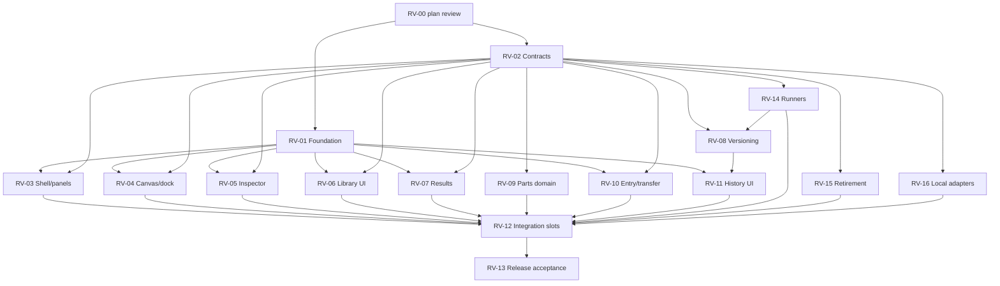

# Delivery plan

## Status

**Hold lifted (user, 2026-09-23, `/delegate start revamp work`).** EXEC-PREFLIGHT passed; first lanes RV-01a and RV-02a are in review. The hold was set 2026-09-22.

Planning is complete: the plan passed four review rounds and every RV-02 contract finding is closed ([reviews.md](reviews.md)). The only remaining step is the user reviewing the plan and lifting the hold.

## Roles and rules

| Role | Who | Does |
|---|---|---|
| Lead | Codex | Plans, assigns bounded tasks, verifies, accepts. Sole writer of this ledger, HANDOFF and ACTION_LOG. |
| Reviewer | Claude | Reviews plans, contracts and every implementation diff. Doesn't implement fixes. |
| Implementer | Gemini/agy | Implements one bounded checkpoint at a time. |

- **Dispatch** uses the `/delegate` skill with this project's roles: Claude as critic and reviewer, Gemini as executor. Record the actual prompt, output, exit status and diff; a process exiting 0 isn't proof of work.
- **Before the first write dispatch** (EXEC-PREFLIGHT): Gemini does a no-edit run that acknowledges its file boundary. Confirm the allowed writes and test commands, and rehearse an interrupt/timeout. The earlier headless attempt that exited 0 with a permission denial doesn't count. No blanket permission bypasses.
- **One task = one checkpoint.** Each task records its base commit, worktree, exact allowed files (including tests), contract sections, fixtures, requirement IDs, screens, acceptance commands and stop conditions. Stop and escalate if a task needs files outside its list or hits an ambiguity; never invent semantics. "Implement RV-14" is not a valid task.
- **Lanes.** At most 3 implementation lanes, each in an isolated worktree with its own dependency install (never symlinked). Shared contracts come before consumers; kernel patches are exclusive.
- **Shared files have one writer at a time.** `src/App.tsx`, `src/state/editor.ts`, `src/domain/model.ts`, `src/persistence/projects.ts`, `src/components/StudioMenu.tsx`, and any reserved shared CSS, contract or package files change only in a reserved RV-12 integration slot. There is one slot at a time, holding an exact file subset; it is released explicitly when accepted.
- **Interruption.** Keep ownership and the partial diff and inspect them before retrying. Never auto-reset a worktree. Retry only the unaccepted scope.
- **Acceptance** needs Claude's review of the actual diff and test output, plus Codex verification. UI built on fixtures is *reviewable*, not integrated, until it runs on real state. A change to an accepted contract invalidates the tasks that depend on it.

## Dependency graph

Suggested first lanes once the hold lifts, and only on disjoint files: (1) foundation, (2) shared schema/validators, then pure runners, (3) repository base (RV-16a).

## Packages

| ID | Owner | Scope (owns) | Needs | Done when |
|---|---|---|---|---|
| RV-00 | Claude | Plan review | — | **Accepted** |
| RV-01 | Gemini | `components.json`, `src/styles.css`, exact `components/ui/` files, new `components/studio/`, specimen + tests; package/fonts only while holding the dependency lock | RV-00 | R02/R11; component/browser checks; matches the foundation canvas. No domain edits. |
| RV-02 | Codex / Claude | [contracts/](contracts/README.md) | RV-00 | **All findings closed**; shared TypeScript types are a later Gemini task |
| RV-03 | Gemini | New `features/workspace/`, `TopBar.tsx`, `ActivityRail.tsx`, shell tests | 01, 02 | R03/R04/R11; reducer tests; screens 22A nav, 13A/B, 14A, 18A, 23A–G; reload/viewport |
| RV-04 | Gemini | `ArchitectureCanvas`, `SubsystemNode`, `TrafficEdge`, `CanvasNotes`, `CanvasContextMenu`, `DiagramOrganization`, `layout/CanvasFloatingDock` + canvas CSS/tests | 01, 02 | R05/R11; notes/group/export/viewport journeys; 2A, 16A–D. No engine/editor edits. |
| RV-05 | Gemini | `OpenInspector`, `OpenConnectionEditor`, `OpenWorkloadControls`, `NumberField`, `SubsystemsPanel`, new typed forms | 01, 02; editor API via RV-12 | R06/R11/R13: no partial mutation, one undo, stale detection, truthful readiness |
| RV-06 | Gemini | New `features/library/` | 01, 02 (fixtures OK) | R07/R11; final acceptance needs RV-09 + integration; screens 12A–C, 16E |
| RV-07 | Gemini | `ResultsStrip`, `OpenMetricsPanel`, `ResultsPanel`, new `features/results/` | 01, 02 | R09/R11; identical numbers for the same model; partial/completed/imported states. No kernel instrumentation. |
| RV-08 | Gemini (sub-steps) | New `domain/versioning/` + repository files | 02, RV-14a, RV-16a | R08; see sub-steps below |
| RV-09 | Gemini | New `domain/parts/` + part repository | 02 | R07/R11: independent copies, exclusions, collisions, limits, failed placement leaves state unchanged |
| RV-10 | Gemini | Entry components, exporters, `ExamplesPanel`, `DiagramExport` (when reserved) | 01, 02 | R10/R11: escaping, formula safety, Unicode, empty data; keep SVG/PNG/JSON |
| RV-11 | Gemini | New `features/history/`, `RevisionsPanel`, tests (`StudioMenu` via RV-12) | 01, 02, RV-08 APIs | R08/R11: 22A–F; no false verified/team labels; keyboard conflict resolution; failed publish keeps state |
| RV-12 | Gemini | Shared files, one slot at a time | Accepted features | Real state wired; cutover tested; old UI removed; no duplicate commands or fixtures in production |
| RV-13 | Codex / Claude | Release verification | All, incl. RV-14 S01–S05 | [Release gates](verification.md#release-gates) |
| RV-14 | Gemini (sub-steps) | New scenario/behavior/compiler/runner modules; kernel only via exclusive sub-step | 02 | R13: S01–S05 success/failure; limits, cancellation and truncation explicit; fingerprints available to RV-08 |
| RV-15 | Gemini | `MetricsPanel`, legacy Inspector/internals/controls, legacy engines, per the manifest ([architecture §6](architecture.md#6-legacy-retirement)) | 02; replacements accepted | Unsupported formats rejected; old DB untouched; no legacy worker; each retired test justified |
| RV-16 | Gemini (sub-steps) | New local repository/run/artifact/preference adapters; Dexie boot only via RV-12 | 02 | R14: works offline; no credentials or vendor IDs; save-failure and stale-write tests. No remote code. |

Ownership notes:
- **RV-05 vs RV-15.** RV-05 owns `OpenInspector`; RV-15 owns the legacy `Inspector` and never modernizes code scheduled for retirement. A file moves to retirement only after its replacement is accepted.
- **Kernel files.** No UI task owns them.
- **Retirement edits.** RV-15 writes the deletion manifest; the serialized edits happen in RV-12 slots.

### Sub-steps

| Step | Needs | Delivers |
|---|---|---|
| RV-14a | RV-02 | Scenario readiness, canonical manifest, evidence interface, trace envelope |
| RV-14b | 14a | S01 machine interpreter |
| RV-14c | 14a | S03 data operations (parallel with 14b) |
| RV-14d | 14a | Retained-kernel characterization, finite-input/trace adapter, S02 outcomes |
| RV-14e | 14d **accepted** | S04 fault scheduler with exact failure accounting |
| RV-14f | 14b–e | S05 composition/refinement; five-family acceptance |
| RV-16a | RV-02 | New namespace, immutable rows, compare-and-set/receipts, preferences, quota/recovery, repository port |
| RV-16b | 16a, RV-08 history, RV-14 evidence | Import/export, pruning, recovery journeys |
| RV-08a | RV-14a, RV-16a (pure logic can use a port fake; durable acceptance needs 16a) | Snapshot/evidence storage, eligibility predicates |
| RV-08b | 08a | Branch working copies, autosave/checkpoints, switch/save-failure |
| RV-08c | 08b | Typed three-way diff/merge, reference conflicts |
| RV-08d | 08c, RV-14a–f all accepted | Isolated candidate runs; eligibility across all five families |
| RV-08e | 08d, RV-16a | Atomic publish, default closure/reopen, stale-head cases |
| RV-08f | 08e | History round trip, retention/reference integrity |

RV-14d and RV-14e are always serialized. RV-16b follows versioning integration, which avoids a dependency cycle.

**Integration order:** foundation → shell/canvas → inspector → library/results/entry → history. The current-schema, runner and retirement slices are coordinated before incompatible consumers are wired in.

## Task ledger

| ID | Status | Next |
|---|---|---|
| PLAN, RV-00, RV-02 | ACCEPTED (planning) | — |
| EXEC-PREFLIGHT | ACCEPTED 2026-09-23 | agy runs headless with `--dangerously-skip-permissions` (user choice) inside per-task worktrees; timeouts need a SIGTERM/SIGKILL watchdog (`alarm`/`--print-timeout` don't stop agy) |
| RV-01 foundation (a–h) | ACCEPTED (Claude sign-off 2026-09-23) | Branch `claude/rv-01a-tokens` @ `3631027`. RV-01h matched Button/fields/checkbox/tabs/toggle-group/tooltip/menus/tags/kbd to the Design System board (computed-style check). Residual (low): primary button text white vs board shell #FBFAF7; field 'filled' white state needs a placeholder; Button loading+asChild shows no spinner; toast has no layering token (contract gap); existing screens inherit the new primitive looks and are restyled in their own packages. Unblocks RV-03/04/05/06/07/10/11 UI work |
| RV-02a–f model core | REVIEW PASS, committed | Head `claude/rv-02f-readiness` @ `e75fc15`. Contract round 2026-09-23 settled D31–D34 (manifest shape, mode rules -> readiness, recursive refinement storable, minor readings). Next: RV-02g apply D32/D33 to validate.ts, then manifest builder + fingerprint |
| RV-03a panel reducer | REVIEW PASS, committed | `claude/rv-03a-panel-reducer` @ `e9e3b58` (pure, 55 tests). Gaps: gesture payloads, activeOverlay representation, announce wording |
| RV-03b top bar + rail (22A) | REVIEW PASS, committed | `fe2bda7`, merged on `claude/rv-01a-tokens` @ `2262d55`. Temporary `header.canvas-first-topbar { z-index:1100 }` keeps the top bar above the RV-12-reserved StudioMenu backdrop (remove when StudioMenu becomes a DropdownMenu). Rail label clipping fixed in RV-03c `a1af2bd` (board short labels, full aria-labels; supplied 22A app mark) |
| RV-04a canvas dock (16A) | REVIEW PASS, committed | `c7a4020`, on foundation line. 16B overflow actions not in app (not invented); arbitrary shadow until elevation tokens exist; RV-04b `9fc4367`: 'More canvas tools' overflow popover on narrow screens (16B) and raised/popover/floating shadow tokens. Foundation line now `11b6bb0` |
| RV-02f remaining readiness rejects | REVIEW PASS, committed | `claude/rv-02f-readiness` @ `e75fc15`. 'Missing pipeline outputs' read as unresolvable output/error port (S03 shows unconnected outputs are legal) — contract round to confirm |
| RV-01 (rest), RV-03 … RV-16 | BLOCKED | Dependencies as ordered above |

Statuses: READY → CLAIMED → IN_PROGRESS → REVIEW → ACCEPTED, or BLOCKED (with the specific dependency named). A paused task stays owned until it is released.
