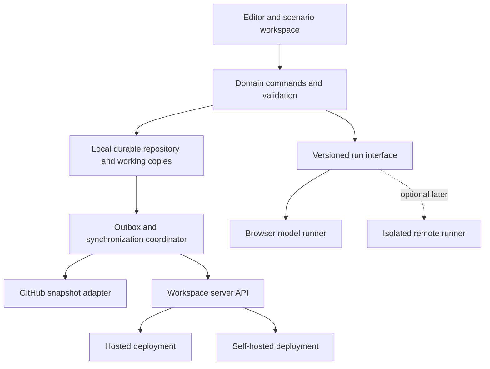

# Local, hosted and self-hosted architecture

Status: proposed architecture boundaries, 2026-09-21. Future hosted/self-hosted bundles, remote synchronization to GitHub/our servers and multi-user functionality are confirmed direction. User confirmed async branches/review/merge first, live coediting later. Provider and deployment topology remain design choices, not implementation authorization.

## One product core, deployment adapters

Keep the editor, model/behavior schemas, validation, scenario compiler, diff/merge and portable formats independent of authentication/storage vendors. Local operation is a real mode of the same product, not a temporary mock backend. Hosted delivery must not turn every edit/run into a mandatory network request.

| Bundle | Required behavior | Must not assume |
|---|---|---|
| Local | Offline model editing/runs, durable local records, export/recovery | Login, hosted API or GitHub availability |
| Hosted | Same local client plus managed sync, identity, permissions and collaboration | Client declarations grant permissions |
| Self-hosted | Same core and server protocol, configurable endpoint/identity/storage, documented deployment/backup/upgrade | OpenAI/company SaaS or GitHub is mandatory |

Self-hosted must include a supported server deployment path, not merely a static frontend ZIP that points to a managed service. Initial packaging might be container-based, but choose its concrete operational contract separately. Test offline assets/fonts and first-load requirements explicitly before claiming offline support.

## Data ownership

| Data | Local persistence | Synchronization policy |
|---|---|---|
| Elements, connections, authored notes/layout, scenarios, reusable parts | Yes | Explicitly shared project content |
| Branches, immutable commits, publications | Yes | Versioned objects and mutable refs with expected-head checks |
| Large traces/results | Local artifact store | Explicit publish/upload; manifest/hash; retention limits |
| Selection, viewport, panel/dock preferences, dirty form text | Yes where useful | Personal; not shared model changes |
| Presence/cursors | Ephemeral | Optional realtime channel; no project history |
| Membership, verified identity, approval/access decisions | Cached hints only | Server authoritative |
| Credentials | Separate credential facility | Never in project JSON, Git commits or trace payloads |

Browser-local save, remote sync and reviewed publication are separate states. UI may say “Saved on this device · sync pending”, not a single ambiguous green Saved badge. Revoked remote access does not erase an offline working copy or imply it can still publish.

## Boundaries needed now

- Stable project/document/element/branch/scenario IDs independent of provider IDs or names.
- Domain command APIs with atomic change groups and origin metadata. Avoid spreading whole-project replacement mutations across components.
- Separate durable document content, immutable history, run artifacts, personal preferences and transient presence.
- Explicit revision tokens and expected-head updates. No last-write-wins based on wall clocks.
- Author claims record origin: local self-reported actor versus authenticated server principal. A display name is never permission evidence.
- Versioned portable representation and deterministic canonicalization. Unknown future behavior versions must not silently run with old semantics.
- Repository/run/artifact/sync interfaces defined around actual use cases, not a universal abstraction framework. Implement only local adapters initially unless scope changes.

## GitHub synchronization

Treat GitHub as a versioned snapshot/review destination, not the per-keystroke collaboration server. The GitHub APIs expose file trees and commit references; tree updates are committed before a branch reference advances. This supports explicit snapshot push/pull and PR review. [Git trees](https://docs.github.com/en/rest/git/trees), [Git references](https://docs.github.com/en/rest/git/refs).

Proposed flow: choose repo/path/branch → serialize deterministic project manifest and authored model/scenarios → create snapshot commit → advance branch without forced history replacement → open/review PR if requested → pull and structurally validate before adoption. Preserve unrelated repository paths. Keep large traces out of ordinary model files, using explicit artifact references if published.

Studio commit IDs and Git commit SHAs are different identities; store a mapping. A Studio local commit need not immediately create a Git commit. Git text merge success does not guarantee valid graph references/behavior: run domain merge/validation after synchronization.

Concurrent remote edits require fetch/reconcile/retry, not blind overwrites. Never assume the reference API alone supplies an arbitrary compare-and-swap primitive; the chosen adapter must prove its expected-head semantics under races. If hosted server and GitHub both exist, designate one authoritative shared branch remote; other remotes are explicit mirrors/imports unless a multi-remote reconciliation design is approved.

## Our server synchronization

Local mutation and its outbox entry must persist atomically. Send idempotent operations or immutable objects/ref changes with project/account scope, operation ID, base revision and schema version. Server validates permissions, structure and expected versions, commits durably, then acknowledges. Retry after disconnect is safe; acknowledgement loss must not duplicate a commit/publication.

Pull uses a resumable cursor or version manifest and explicit deletions/tombstones. Compaction/retention must not resurrect deleted entities when an old client reconnects. Revocation or validation rejection keeps rejected work recoverable as a private fork/export. Switching accounts cannot send another account's pending outbox.

The protocol must distinguish local publish (personal branch merge) from publication to a shared protected branch. Server permissions and checks run again at remote publication. Importing a local “approved” flag cannot grant team approval.

## Multi-user work has two separate problems

1. **Async collaboration:** branches, comments, reviews, permissions and atomic merge/publication. This naturally extends the planned immutable history and domain merge.
2. **Simultaneous editing:** concurrent working-document changes, presence, personal undo, dirty form conflicts and offline convergence. This needs a separate collaboration design; immutable Git commits alone do not provide it.

Yjs is a candidate for shared working documents: its shared types merge concurrent updates and its providers are network-independent; its UndoManager can scope undo to transaction origins. These are useful mechanisms, not automatic enforcement of graph validity or authorization. [Yjs introduction](https://docs.yjs.dev/), [selective undo](https://docs.yjs.dev/api/undo-manager).

CRDT convergence does not decide whether two authors' capacity changes are semantically acceptable. Working-document convergence and explicit branch merge/review remain separate. Never rewrite immutable published commits with CRDT updates. Capture revisions at a known durable boundary, and keep a run pinned to its starting snapshot when collaborators edit.

If live coediting is a first-release requirement, prove graph-invariant handling, delete/edit, stale Apply, transaction-group undo and offline replay with a small prototype before freezing editor state. If later, retain typed command boundaries now without installing a CRDT as speculative infrastructure.

## Historical plan conflict

`specs/shared-team-architecture.md` previously selected Supabase/Google login plus Hocuspocus/Yjs, and disabled shared editing while disconnected. Those are historical proposals under review, not binding choices for a local-first hosted/self-hosted architecture. Reuse its useful permission/review requirements; reconsider vendor dependence, offline behavior and deployment constraints explicitly.

## Verification before claiming support

- Local: reload/recovery, quota failure, export, offline after assets are available.
- Sync: duplicate/reordered retries, lost acknowledgement, stale head, deletion replay, incompatible schema, account switch and revocation.
- Multi-user: edit/delete conflict, independent-field edits, dirty Apply, per-user undo and run snapshot stability.
- Self-host: fresh deployment, configurable endpoint and identity, backup/restore, upgrade/rollback, no required managed-service calls.
- Hosted: tenant isolation, server authorization, durable publication and artifact access controls.

Reference principle: local-first preserves local data access and responsiveness while adding collaboration; merely caching a server-authoritative app does not establish that behavior. [Ink & Switch, Local-first software](https://www.inkandswitch.com/essay/local-first/).
